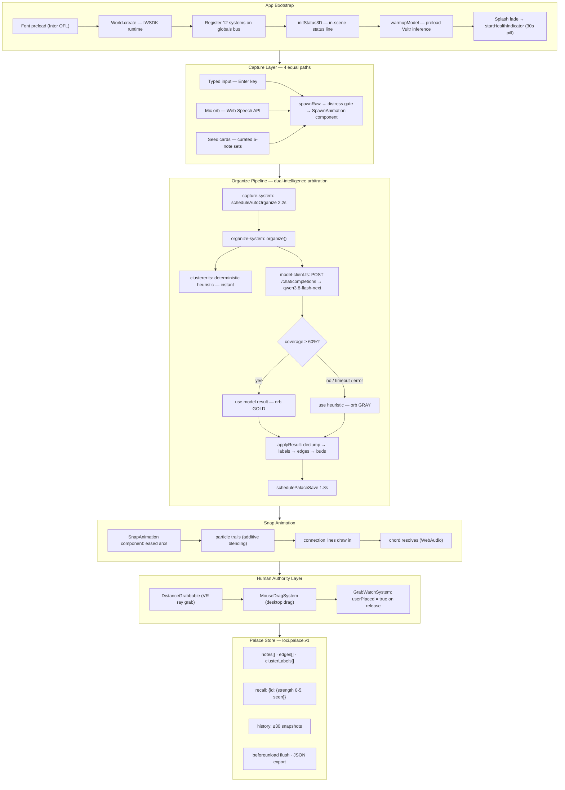
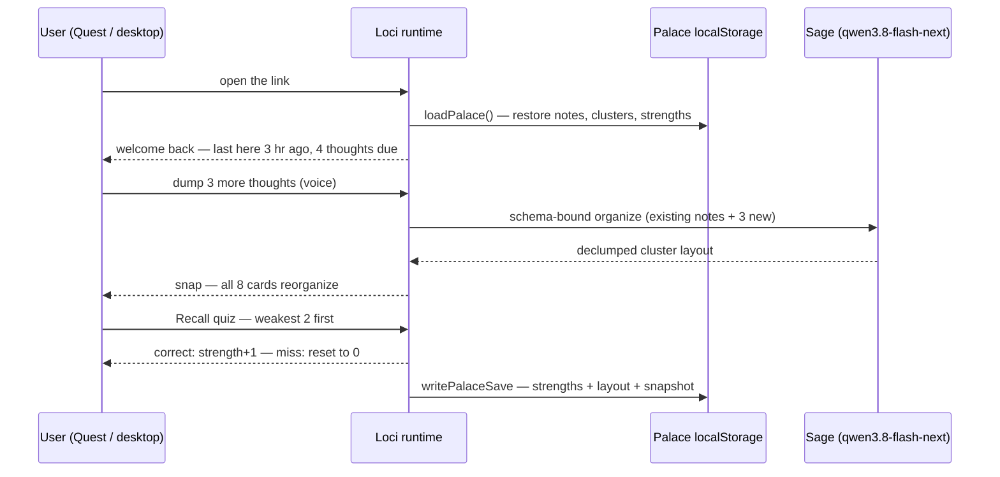
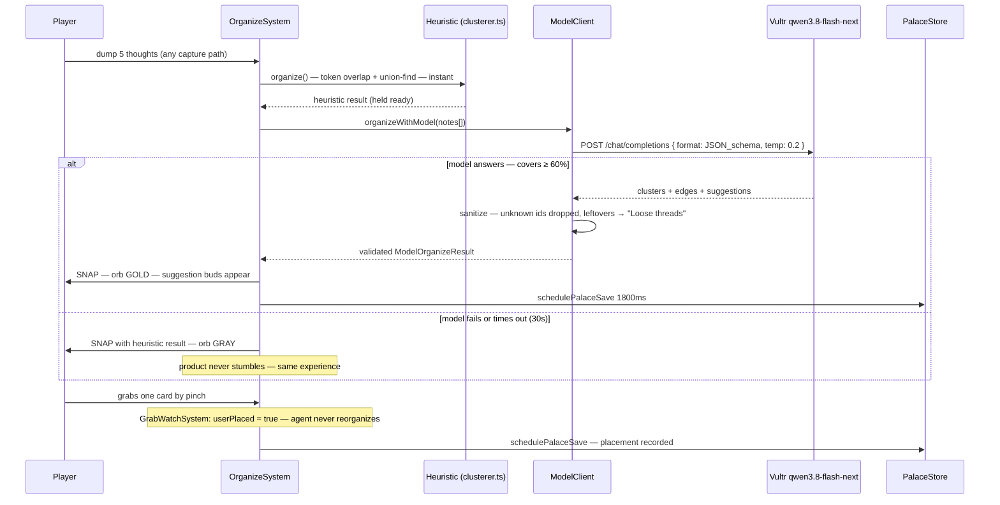
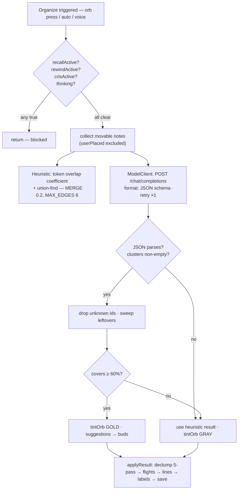
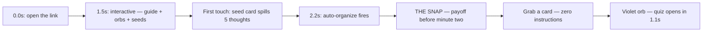
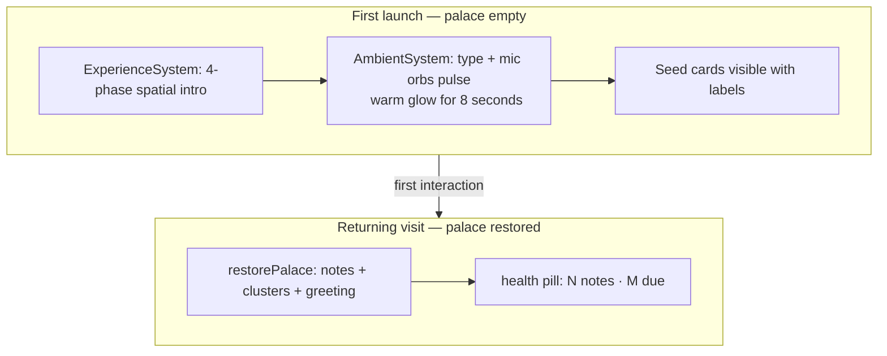
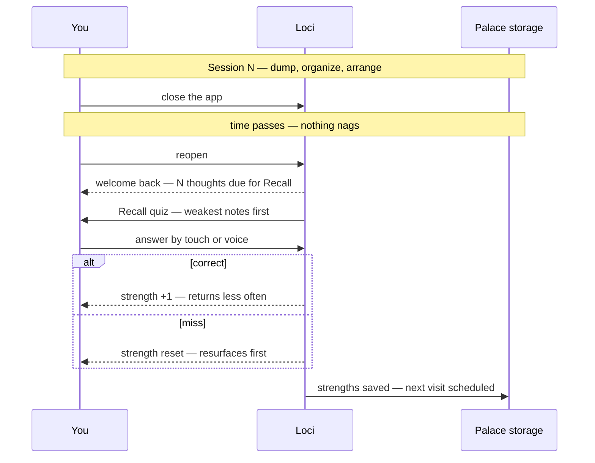
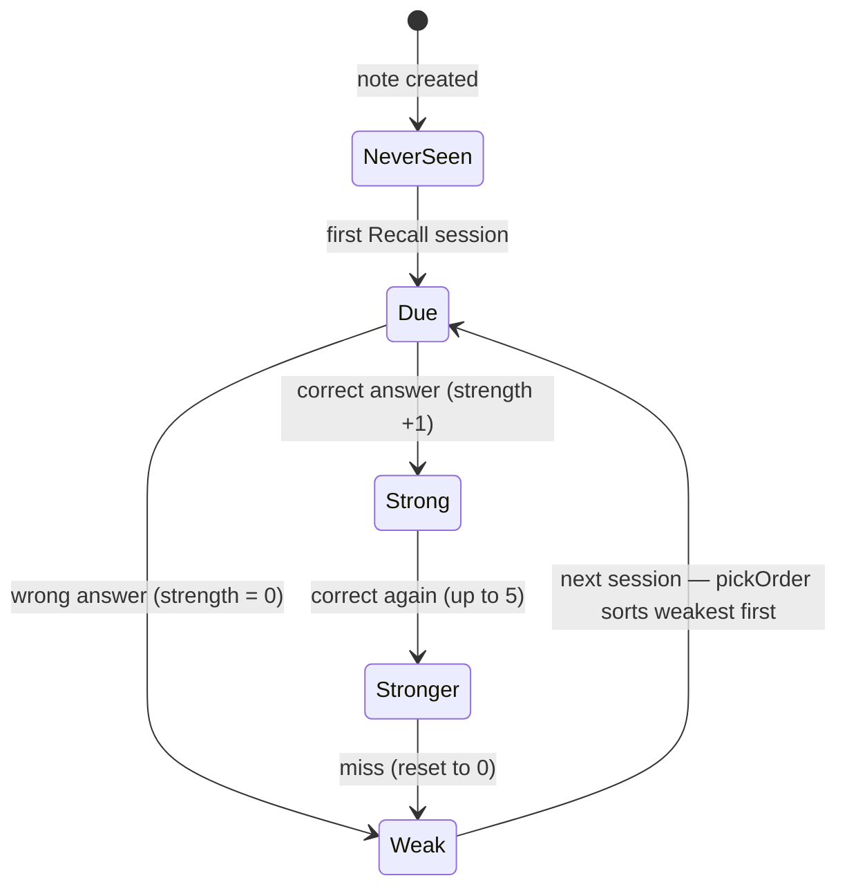
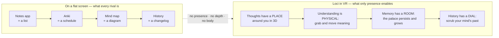

# Loci — Competition Strategy & Technical Architecture

Meta VR Start Developer Competition 2026. Track: **Productivity** ·
Division: **New Experience**. One entry, judged on four equally weighted
criteria (Innovation & Creativity, Experience Design, Technical
Implementation, Polish & Presentation) and eligible for the special awards
below.

Each category documents: what the judges reward, how Loci is built for it
(with implementation references), the full system flow, and its diagram.
All listed features are **implemented and shipped** — verified on the built
app at `https://139-84-174-127.sslip.io`.

---

## Table of Contents

- [1. Best New Productivity Experience](#1-best-new-productivity-experience)
- [2. Best Agentic Interaction](#2-best-agentic-interaction)
- [3. Best First Five Minutes](#3-best-first-five-minutes)
- [4. Best Reason to Come Back](#4-best-reason-to-come-back)
- [5. Best Accessibility Forward Experience](#5-best-accessibility-forward-experience)
- [6. Boldest Original Concept](#6-boldest-original-concept)
- [7. Judge's Choice](#7-judges-choice)
- [8. Documented Limits](#8-documented-limits)

---

## 1. Best New Productivity Experience

**What the category rewards:** tools designed around a recurring daily
moment — task management, creative tools, habits tied to a recurring
context. Hands-first implementation required.

**How Loci covers it:** the entire experience is a recurring ritual — dump
scattered thoughts, watch Sage snap them into a constellation, arrange by
hand, return the next day for Recall. Not a task list ported to VR: a
thinking environment designed around how memory actually works (method of
loci, spaced repetition).

**Implementation:** capture pipeline (`capture-system.ts` — typed, voice,
spatial keyboard, seed sets) · model-first organize with instant fallback
(`organize-system.ts`, `model-client.ts`, `clusterer.ts`) · snap with
particle trails (`snap-system.ts`) · hand arranging (`mouse-drag-system.ts`,
`DistanceGrabbable`) · persistence + export (`palace-store.ts`).

### System flow — full pipeline

### Return-visit loop

---

## 2. Best Agentic Interaction

**What the category rewards:** AI as a core part of the experience —
context-aware assistance, autonomous analysis, transparent agent behavior.

**How Loci covers it:**

- Sage is a schema-constrained model call (qwen3.8-flash-next via Vultr) — clusters,
  cross-cluster edges, and expand/challenge suggestions
- **Model-exclusive evidence:** suggestion buds can only come from the model
  (the fallback organizer has no suggestions field), so every bud on screen
  is visible proof of agency
- **The gold/gray orb** records which intelligence organized the current
  layout — gold = model, gray = local fallback
- **Retry-then-fallback:** heuristic result is held ready before the request;
  the model must cover ≥60% of notes to win — the product never stumbles
- **Voice answering** in Recall (`answerByVoice()`)

**Implementation:** `model-client.ts` (schema + retry + sanitization),
`organize-system.ts` (`applyBest`, `tintOrb`), `recall-system.ts`
(`answerByVoice`).

### Dual-path arbitration — full sequence

### Agentic decision tree

---

## 3. Best First Five Minutes

**What the category rewards:** how fast the experience explains itself,
teaches interaction without a wall of text, and delivers a payoff.

**How Loci covers it:** narrative intro (four phases, not a tutorial),
first capture within one touch of landing, auto-organize 2.2 s after
capture, snap completes in under a second locally (6–11 s with Sage warm,
covered by the thinking beat). Measured on the built app: boot to
interactive **1.5 s**, recall panel open **1.1 s**.

**Implementation:** `experience-system.ts` (spatial intro), `capture-system.ts`
(seed sets + auto-organize), `recall-system.ts` (quiz panel), `layout.ts`
(declump so nothing overlaps).

### Timed opening sequence

### Discovery mechanics

---

## 4. Best Reason to Come Back

**What the category rewards:** visible growth between sessions and a loop
that pulls the user back tomorrow.

**How Loci covers it:** per-note memory strength (0–5) persisted in the
palace; Recall serves the weakest first; misses resurface first — the
schedule is built from performance, not guilt. The palace itself grows, and
Rewind scrubs that growth backward through physical space.

**Implementation:** `palace-store.ts` (`RecallState`, 30-snapshot history),
`recall-system.ts` (`pickOrder`, grading), `rewind-system.ts` (spatial dial).

### Cross-session retention loop

### Retention state machine

---

## 5. Best Accessibility Forward Experience

**What the category rewards:** voice alternatives for hands, high-contrast
modes, or experiences inclusive by default.

**How Loci covers it:**

- **Colorblind-safe palette — verified, not claimed:** the six accents were
  searched under Viénot deutan/protan/tritan simulation (worst pair
  distance 72.2; the original palette collapsed to 1.4 under protanopia)
- **Text scaling, live:** the Aa orb cycles 100/125/150% across every label
  in the scene
- **Reduced motion respected:** animations skip when the OS asks
- **Voice alternative to hands:** mic orb + spoken quiz answers
- **Hands alternative to voice:** spatial keyboard — works everywhere,
  including Quest browsers (which lack speech recognition — documented)
- **Safety that reaches everyone:** the crisis panel pairs its message with
  a calm audio tone
- **High-contrast mode:** HC button switches HUD and overlays to
  pure black/white
- **One hand, seated:** all affordances within a two-foot arc, no locomotion

**Implementation:** `palette.ts` (verified accents), `media-queries.ts`
(reduced motion), `speech.ts` + `capture-keyboard.ts` (voice/typed),
`crisis-panel.ts` (calm tone), `styles.css` (HC styles).

### Accessibility input/output matrix

```mermaid
flowchart LR
  subgraph INPUTS["Input — every channel works alone"]
    I1["Voice: mic orb (desktop)"]
    I2["Hands: pinch-grab (Quest)"]
    I3["Typed: type orb → spatial keyboard"]
    I4["One finger: seed cards + orbs"]
    I5["Mouse: drag + click (desktop)"]
  end
  INPUTS --> GATE["Distress gate → Organize pipeline"]
  GATE --> OUTPUTS
  subgraph OUTPUTS["Output — every signal redundant"]
    O1["Color: CVD-verified palette"]
    O2["Glyphs: + and ? marks on buds"]
    O3["Audio: chord, ping, calm tone"]
    O4["Text scale: Aa orb 100-150%"]
    O5["HC mode: pure black/white"]
  end
  OUTPUTS --> USER["Same experience regardless of
  which channel or ability"]
```

---

## 6. Boldest Original Concept

**What the category rewards:** an idea whose core loop depends on presence,
spatial depth, or hands — one that would fall apart on any other platform.

**The claim, drawn:**

The method of loci is a 2,000-year-old memory technique that always needed
an imagined place. VR is the first medium where the place is real — and the
Rewind dial (scrubbing your own mind's history through physical space) is
the beat no flat screen can imitate.

---

## 7. Judge's Choice

The wildcard. Loci's angle: genuine cognitive science (method of loci,
spaced repetition), ethical AI (distress gate, transparent gold/gray agent
status), and craft (zero-asset synthesized audio, canvas-rendered type,
hand-built Three.js). No specific changes — polish is the vehicle.

---

## 8. Documented Limits

| Limit | Why it's accepted |
| --- | --- |
| Voice capture desktop-only | Quest browsers have no Web Speech API; the spatial keyboard is the equal path there |
| Streaks rejected | Conflicts with the no-guilt design principle — Recall scheduling does the work instead |
| Web companion not deployed | Repo-only context for now; the Quest app is the submission |
| Foveation 0.8 | Peripheral softness is the performance trade for 72fps |
