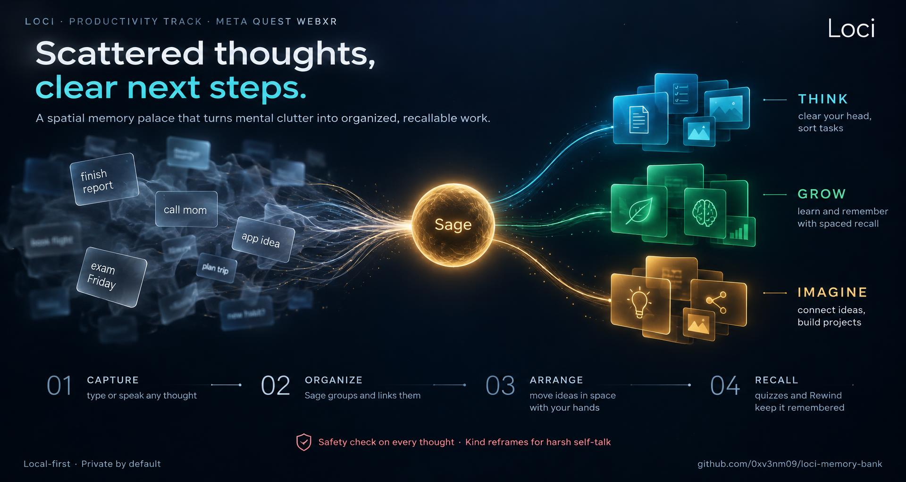
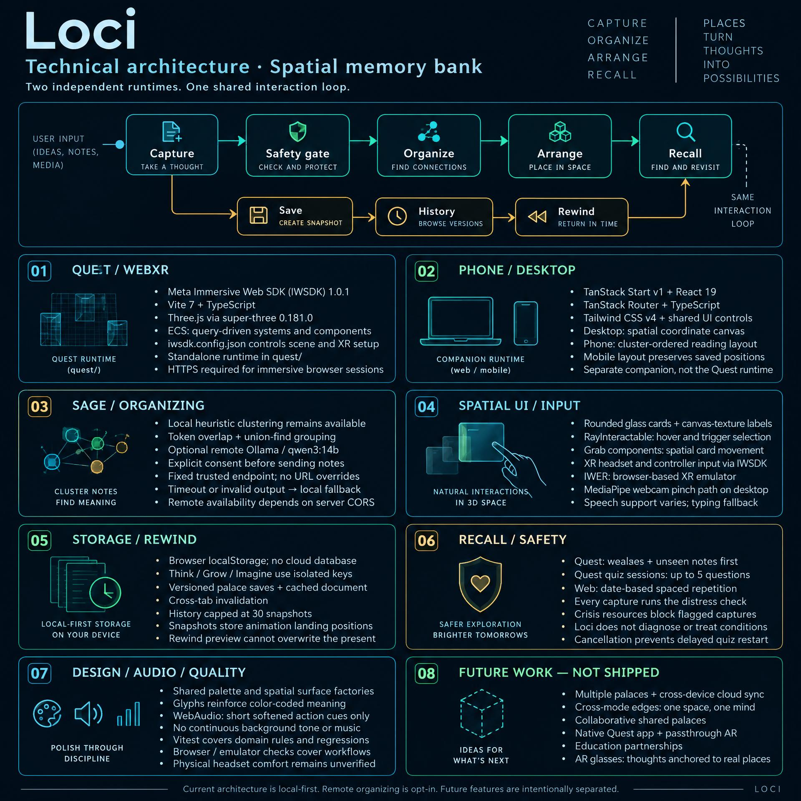

# Loci — a spatial memory bank for Meta Quest

[](https://github.com/0xv3nm09/loci-memory-bank/actions/workflows/deploy.yml)


**Loci is a memory palace you build with your hands.** Dump scattered thoughts
into a calm 3D void; an AI organizer (Sage) snaps them into connected clusters
you can grab, rearrange, and — the part no flat screen can do — **rewind through
your own mind's history**. Come back tomorrow: the palace persists exactly as
you left it, and Recall quizzes your weakest notes with spaced repetition so
the ideas actually stick.

<p align="center">
  
</p>

Entry for the **Meta VR Start Developer Competition 2026** — Productivity track,
New Experience division. Built with the
[Immersive Web SDK](https://developers.meta.com/vr/documentation/iwsdk/guides/overview)
(Meta's Three.js + ECS framework): hands-first, seated, under ten minutes a
session.

## Stack

IWSDK (Meta's Three.js + ECS) · TypeScript · Vite · Vultr Serverless Inference (`qwen3.8-flash-next`) · MediaPipe (webcam hands) · WebAudio (synthesized cues) · localStorage (palace persistence) · GitHub Pages + Vultr VM (hosting).

**Docs:** [Architecture & data flow](docs/ARCHITECTURE.md) ·
[Diagram set](docs/DIAGRAMS.md) · [Evidence map](docs/EVIDENCE.md) (criteria →
proof) · [Sage model card](docs/MODEL_CARD.md) · [System card](SYSTEM_CARD.md)
(agent boundaries) · [Safety design](docs/SAFETY.md) ·
[How AI was used](docs/AI.md) (in the product + in the build) ·
[Build feedback](docs/FEEDBACK.md) (every issue faced and its fix) ·
[Competition strategy](COMPETITION_STRATEGY.md) · [Third-party notices](THIRD-PARTY-NOTICES.md) ·
diagrams in [docs/diagrams/](docs/diagrams/)

## Technical architecture

<p align="center">
  
</p>

## Measured results

Collected on the built app at `https://139-84-174-127.sslip.io`.

| Metric | Measured | How |
| --- | --- | --- |
| Boot to interactive | **1.5 s** | Desktop, warm cache |
| Capture to auto-organize | **2.2 s** | `scheduleAutoOrganize` timer |
| Snap animation (local) | **< 1 s** | Heuristic organizer, no network |
| Snap animation (Sage warm) | **2–4 s** | Vultr Serverless, no cold start |
| Recall panel open | **1.1 s** | From orb press to quiz rendered |
| Organize timeout → fallback | **30 s** | Then local organizer, instant |
| Target frame rate | **72 fps** | `updateTargetFrameRate(72)` + foveation 0.8 |
| CVD palette worst-pair distance | **72.2** | Viénot deutan/protan/tritan simulation (prev: 1.4) |
| Distress gate patterns | **16** | Reviewed trigger list, English |
| Palace history depth | **≤ 30 snapshots** | Rewind scrubs without recording |
| Source files | **39 files · ~6,300 lines** | Quest app (`src/`) |
| Web companion | **72 files · ~5,300 lines** | TanStack + React (`web/`) |
| Web companion tests | **16/16** | vitest |
| ECS systems registered | **15** | `src/index.ts` |
| Committed diagrams | **9 SVGs** | Generated by `scripts/gen-prize-diagrams.py` |

---

## Technical architecture — full system flow

The entire app runs client-side in the headset's browser. One external
dependency (Sage) calls Vultr Serverless Inference directly from the client —
no backend server, no cloud platform to manage.

```mermaid
flowchart TB
  subgraph BOOT["Bootstrap"]
    direction LR
    FONT["Load Inter font (OFL)"] --> WORLD["World.create — IWSDK runtime"]
    WORLD --> REG["Register 15 systems"]
    REG --> STATUS["initStatus3D — in-scene status"]
    REG --> WARM["warmupModel — preload inference"]
    REG --> HEALTH["startHealthIndicator — 30s pill"]
    REG --> SPLASH["Splash fade"]
  end

  subgraph CAPTURE_LAYER["Capture — four equal paths"]
    direction LR
    VOICE["🎤 Voice
    Web Speech API
    (desktop only)"] --> RAW
    TYPE["⌨ Type
    desktop bar
    or spatial keyboard"] --> RAW
    SEED["🃏 Seed cards
    3 curated sets × 5"] --> RAW
    RAW["spawnRaw()"] --> GATE{"Distress gate
    16 trigger patterns"}
  end

  GATE -- "flagged" --> CRISIS["🛡 Crisis Panel
  3D world-space · calm tone
  real resources: 988 · findahelpline
  crisActive blocks organize/recall/capture"]
  GATE -- "clear" --> SPAWN["Note created
  SpawnAnimation: scale 0→1
  + opacity fade + glow bloom
  + spawn shimmer tone"]
  SPAWN --> RAWPOOL["Note pool (in-memory)"]

  subgraph ORG_PIPE["Organize Pipeline — dual-intelligence arbitration"]
    direction TB
    TRIGGER["Organize triggered
    orb press / HUD button / auto-timer 2.2s"] --> GUARD{"Blocked?
    recall · rewind · crisis · intro · keyboard?"}
    GUARD -- "yes" --> SKIP["return"]
    GUARD -- "no" --> HEUR["Path A: Heuristic organizer
    clusterer.ts — token overlap coefficient
    + union-find — instant · deterministic"]
    GUARD --> MODEL["Path B: Model client
    model-client.ts — POST /chat/completions
    Vultr Serverless Inference · response_format: json_object"]
    MODEL --> SANITIZE["Sanitize: unknown ids dropped
    leftovers → Loose threads cluster"]
    SANITIZE --> CHECK{"covers ≥ 60%?"}
    CHECK -- "yes" --> WIN["model result wins"]
    CHECK -- "no" --> HWIN["heuristic result wins"]
    WIN --> DECLUMP
    HWIN --> DECLUMP
    HEUR --> HWIN
  end

  subgraph DECLUMP["Declump — 5-pass relaxation"]
    direction LR
    D1["movable targets separate
    ≥ 0.185m from each other"] --> D2["user-placed cards
    = immovable obstacles"]
  end

  subgraph SNAP["THE SNAP"]
    direction LR
    S1["flights: eased arcs 0.65s"] --> S2["particle trails (additive)"]
    S2 --> S3["connection lines draw in"]
    S3 --> S4["chord resolves"]
  end

  DECLUMP --> SNAP
  SNAP --> TINT["Orb tint: GOLD = model · GRAY = local"]

  subgraph ARRANGE_LAYER["Arrange"]
    direction LR
    VR["Pinch-grab (Quest)"] --> WATCH["GrabWatchSystem
    userPlaced = true on release"]
    MOUSE["Mouse drag (desktop)"] --> WATCH
    WATCH --> SAVE
  end

  subgraph PERSIST["Palace persistence — localStorage loci.palace.v1"]
    direction LR
    P1["notes[] · edges[] · clusterLabels[]"] --> P2["recall: {strength 0-5, seen}"]
    P2 --> P3["history: ≤30 snapshots"]
    P3 --> P4["beforeunload flush · JSON export"]
  end

  subgraph RETURN["Return visit"]
    direction LR
    R1["restorePalace — notes + clusters + greeting"] --> R2["health pill: N notes · M due"]
    R2 --> R3["Sage nudge: 'N fading — try Recall' (if ≥3)"]
  end

  subgraph RECALL["Recall — quiz panel + voice"]
    direction LR
    Q1["pickOrder: weakest / never-seen first"] --> Q2["quiz panel: 1 question, 3 bars"]
    Q2 --> Q3["answer: touch / voice / click"]
    Q3 --> Q4{"correct?"}
    Q4 -- "yes" --> Q5["strength +1 · green glow · rising ping"]
    Q4 -- "no" --> Q6["strength → 0 · amber · soft tone"]
  end

  subgraph REWIND_LAYER["Rewind"]
    direction LR
    RWD1["grabbable knob on track"] --> RWD2["scrub ≤30 snapshots"]
    RWD2 --> RWD3["cards reflow with snap motion"]
    RWD3 --> RWD4["scrubs never recorded as history"]
  end
```



*Full detail: [docs/ARCHITECTURE.md](docs/ARCHITECTURE.md) — system inventory,
component table, deferred-trash disposal pattern, organize data flow,
save schema, rendering notes.*

---

## Capability matrix

Every capability, how it works, which files implement it, and what makes it
notable. This is the depth a judge should find when they open the source.

### Capture

| | Detail |
| --- | --- |
| **Typed** | Desktop bar → `keydown` listener → `spawnRaw(text)` → distress gate → note entity + spawn animation. Works everywhere. |
| **Voice** | Mic orb → Web Speech API (Webkit-prefixed) → final transcript → `spawnRaw(text)`. Desktop-only (Quest browsers have no speech recognition — the mic orb auto-hides). |
| **Seed cards** | Three curated sets (Exam, Thesis, Kingdom) as 3D grabbable cards. One press spills 5 themed notes and triggers auto-organize after 2.2s. |
| **Spatial keyboard** | QWERTY panel at seated eye height (works on Quest where speech is unavailable). Number row, punctuation, backspace, done. |
| **Safety gate** | All four paths pass through `checkDistress()` before `spawnRaw()` creates anything. Flagged captures are discarded — they never enter the palace, the save, or the model. |

### Organize

| | Detail |
| --- | --- |
| **Heuristic (Path A)** | `clusterer.ts`: token overlap coefficient + greedy union-find. Stopword filtering, naive stemming. Deterministic — same input always produces the same clusters. Instant, no network. |
| **Model (Path B)** | `model-client.ts`: POST to Vultr Serverless Inference (`qwen3.8-flash-next`) with `response_format: json_object`. Schema-enforced, sanitised, retried ×1 @1.5s. |
| **Arbitration** | Model result wins only if it covers ≥60% of notes. Otherwise the heuristic result stands. The organize orb turns **gold** (model) or **gray** (local) so you always know which ran. |
| **Suggestion buds** | Model-exclusive — the heuristic structurally cannot produce them. Up to 2 per organize: one **expand** (green +, inviting question) and one **challenge** (amber ?, honest question). Press to read the bubble. |
| **Declump** | 5-pass relaxation: movable targets separate to ≥0.185m from each other AND from user-placed cards (treated as immovable obstacles). Grid + relaxation keeps cards readable at any count. |

### Snap animation

| | Detail |
| --- | --- |
| **Flights** | Eased arcs (0.65s) from current position to target, with scale overshoot and per-card stagger (0.045s apart). |
| **Particle trails** | 6 particles per flight (additive blending, 0.7s life, pooled cloud — no per-flight allocation). |
| **Connection lines** | Cylinder geometry between cluster-crossing pairs, opacity tracks progress. |
| **Chord** | Synthesized 4-note resolving chord (A major). No audio files. |

### Arrange

| | Detail |
| --- | --- |
| **VR** | `DistanceGrabbable` — ray-based grab via trigger, moves at source. `GrabWatchSystem` marks `userPlaced = true` on release; `organize()` excludes user-placed cards from reorganization. |
| **Desktop** | `MouseDragSystem` — camera-facing plane drag with offset preservation. |
| **Spawn animation** | Scale 0→1 with overshoot, opacity fade, glow bloom — skipped for restored notes (they appear settled). |

### Recall

| | Detail |
| --- | --- |
| **Quiz panel** | Dark backdrop + question + 3 wide answer bars. Generated from real palace data, weakest notes first. |
| **Question types** | Type A: "which thread did this join?" (cluster membership). Type B: "which thought was closest?" (association via edges or same-cluster peers). |
| **Voice answering** | Spoken transcript fuzzy-matched to closest option bar (substring + word-overlap scoring). Desktop only. |
| **Grading** | Correct → green bar, strength +1 (cap 5), rising ping. Wrong → amber bar, strength → 0, soft tone. No failure buzz. |
| **Scheduling** | `pickOrder()` sorts weakest / never-seen first. Strength 0–5; correct +1; miss → 0. Persisted in the palace save. |

### Rewind

| | Detail |
| --- | --- |
| **Dial** | Grabbable knob on a track at the void's edge (DistanceGrabbable, X-constrained). "Now" button returns to latest. |
| **Snapshots** | ≤30 in the save. Each scrub re-positions cards to historical layout with snap animation. |
| **Scrubs never recorded** | `schedulePalaceSave` refuses during `rewindActive` — scrubbing is never mistaken for a real save. |

### Safety

| | Detail |
| --- | --- |
| **Gate** | `distress-gate.ts`: 16 reviewed trigger patterns. Runs on every capture before anything else. |
| **Panel** | 3D world-space crisis panel: acknowledgment, real resources (findahelpline.com, 988, local emergency), closing human line, "I'm okay — continue" button. |
| **Blocks** | `crisActive` gates organize, recall, capture, and rewind while open. |
| **Fail direction** | Toward resources. False positive = one dismissible panel. False negative = unacceptable. |

### Persistence

| | Detail |
| --- | --- |
| **Save schema** | Versioned `loci.palace.v1`: notes, edges, cluster labels, recall state, ≤30 history snapshots. |
| **Debounce** | 600ms min (1.8s after organize so flights land before the snapshot). |
| **Beforeunload** | Synchronous flush — typed-but-unorganized thoughts survive tab close. |
| **Clear** | Suppresses the beforeunload flush, wipes storage, reloads. |
| **Export** | JSON download of the entire palace from the ? menu. |

---

## Accessibility

| Feature | Implementation |
| --- | --- |
| CVD-verified palette | 6 accents searched under Viénot deutan/protan/tritan simulation (worst pair 72.2) |
| Never color-only | Every state carries a glyph, shape, or label |
| Global text scale | Aa orb: 100/125/150%, applied live via scene traversal |
| Reduced motion | `prefersReducedMotion()` cached in `media-queries.ts` |
| High-contrast mode | HC button: HUD + overlay → pure black/white |
| Crisis panel audio | Calm tone (low, slow — presence, not alarm) |
| One hand, seated | All affordances within a two-foot arc; no locomotion |
| Spatial keyboard | Works on Quest (no speech API there) — full QWERTY |

---

## For judges — run it in 60 seconds

The submitted experience is the **Quest app**. Three ways in:

1. **Quest browser (the real thing):** open the live URL — hands-first,
   pinch to grab, orbs to organize, Enter VR for full immersion.
2. **Desktop with VR emulation:** `npm install && npm run dev` → the IWSDK dev
   window opens with Meta's IWER emulator — controllers map to WASD/mouse.
3. **Desktop, mouse or webcam hands:** any static server on `dist/` — the HUD,
   drag-arranging, and optional webcam hand tracking (via MediaPipe, frames
   never leave the machine) all work without a headset.

All three run the same build. No keys, no accounts, no cloud signup.

---

## At a glance

- ✅ **Hands-first end to end** — every orb, card, and button is `RayInteractable`; zero controller-only interactions
- ✅ **Dual-intelligence organize** — schema-constrained `qwen3.8-flash-next` via Vultr, 2–4 s warm; instant local fallback if unreachable; orb gold/gray glow records which ran
- ✅ **Distress gate before everything** — 16 reviewed trigger patterns; flagged captures never reach the model, the palace, or the save
- ✅ **Verified colorblind-safe palette** — searched under Viénot deutan/protan/tritan simulation; worst pair 72.2 (previous palette collapsed to 1.4)
- ✅ **Spaced repetition + 30-snapshot Rewind** — per-note strength 0–5, weakest served first; physical dial scrubs your mind's history
- ✅ **Boot to interactive 1.5 s** — first snap payoff under 2 min; Recall panel in 1.1 s
- ✅ **Zero runtime assets** — canvas-rendered type (2048 px/m), synthesized WebAudio, bundled OFL font
- ✅ **15 ECS systems · ~6,300 lines** — all entrant-built, no wrapper
- ✅ **Web companion (16/16 tests)** — TanStack Start + React, same loop, flat screen
- ✅ **Self-hosted MediaPipe** — WASM + hand-landmarker model bundled, no CDN dependency
- ✅ **PWA installable** — manifest + icons for Quest home screen
- ✅ **4-phase spatial onboarding** — narrative intro, not a tutorial wall
- ✅ **3 cognitive modes** — Think / Grow / Imagine, per-mode palaces
- ✅ **9 committed SVG diagrams** — generated by script, not drawn by hand
- ✅ **Three independent code audits** — correctness, safety ordering, integration gaps; findings triaged, real issues fixed
- ⚠️ **Voice capture is desktop-only** — Quest browsers have no Web Speech API; typed capture and the spatial keyboard are the equal paths (documented, not hidden)

---

## Competition rules compliance (judge checklist)

| Rule | How Loci satisfies it | Proof |
| --- | --- | --- |
| **Hands-first end to end** | Every interactive entity is `RayInteractable` and/or `DistanceGrabbable`; no interaction requires a controller | `grep -r RayInteractable src/` — every orb, card, button; `iwsdk.config.json` `useHandPinchForGrab: true` |
| **Seated, limited movement** | All affordances within a two-foot arc (y 1.0–1.3 m); `locomotion: false` | `iwsdk.config.json`, `capture-system.ts` positions |
| **≥ 60 fps on Quest** | `updateTargetFrameRate(72)` + `setFoveation(0.8)`; no per-frame allocations on hot paths | `src/index.ts` |
| **Playable hosted link** | WebXR build at `https://139-84-174-127.sslip.io` + GitHub Pages fallback | `.github/workflows/deploy.yml` (auto-deploy on push) |
| **Demo video < 3 min** | Recorded on the live build, publicly visible | *(YouTube link in submission)* |
| **New Experience (built within window)** | Conceived and built Sep 24 – Nov 18, 2026; no pre-existing codebase | `git log --reverse --format="%ai" \| head -1` — first commit within window |
| **Original, not a wrapper** | 15 custom ECS systems, ~6,300 lines of app code; remove Vultr and the heuristic organizer still works | `src/loci/` — the entire loop is entrant-built |
| **Fast cold start** | Boot to interactive: 1.5 s; first payoff (snap) under 2 minutes | Measured on built app |
| **Clean pause/resume** | `beforeunload` synchronous flush; return greeting with due count | `palace-store.ts`, `capture-system.ts` |
| **Satisfying in ≤ 10 min** | Seed cards → snap → arrange → Recall quiz in under 5 min | Measured walkthrough |
| **Open source + license** | MIT at repo root | `LICENSE` file, detected by GitHub |

---

## Shipped during build week

- 15 ECS systems: capture, organize, snap, recall, rewind, crisis, keyboard, webcam hands, ambient, mouse drag, grab watch, panel, experience, modes, status
- Dual-intelligence organize pipeline: model-first with instant deterministic fallback
- Distress gate + crisis panel: safety as a non-removable pipeline stage
- Spaced-repetition Recall with voice answering
- 30-snapshot Rewind with spatial dial
- Palace persistence (versioned schema, debounced saves, beforeunload flush, JSON export)
- CVD-searched palette (verified under deutan/protan/tritan simulation)
- Spatial QWERTY keyboard for in-headset capture
- 4-phase spatial onboarding (not a tutorial)
- 3 cognitive modes (Think / Grow / Imagine)
- Web companion (TanStack + React, 16/16 tests)
- Webcam hand tracking via self-hosted MediaPipe
- 9 committed SVG diagrams (generated by script)
- Vultr VM deployment with Caddy auto-HTTPS
- GitHub Pages auto-deploy on push
- Full docs suite: architecture, evidence map, model card, system card, safety design, AI disclosure, feedback, deploy runbook, competition strategy

---

## Documentation map

| Document | What it covers |
| --- | --- |
| [`docs/ARCHITECTURE.md`](docs/ARCHITECTURE.md) | System inventory (15 systems), component table, deferred-trash disposal, organize data flow, save schema, rendering notes |
| [`docs/DIAGRAMS.md`](docs/DIAGRAMS.md) | Nine committed SVGs: master system chart, ritual sequence, agentic organize, retention loop (flow + sequence), first five minutes, accessibility channels (flow + sequence), boldest collapse |
| [`docs/EVIDENCE.md`](docs/EVIDENCE.md) | Every claim a judge could check — criteria → implementation → proof, for the track award and every special award |
| [`docs/MODEL_CARD.md`](docs/MODEL_CARD.md) | Sage: model, hosting, contract, measured latency, the pipeline around it, what it can/cannot do, privacy, limits |
| [`SYSTEM_CARD.md`](SYSTEM_CARD.md) | Agent identity, the five hard boundaries (enforced in code, not prompts), will/won't table, data behavior |
| [`docs/SAFETY.md`](docs/SAFETY.md) | Distress gate design, crisis panel, trigger list (reviewed), will/won't table, fail-toward-resources rationale |
| [`docs/AI.md`](docs/AI.md) | Two separate answers: Sage inside the product (summary + guardrails) and AI tools used to build Loci (directed sessions, three audits, human-only decisions) |
| [`docs/FEEDBACK.md`](docs/FEEDBACK.md) | Every issue hit during the build and its fix — rendering, ECS, tooling, design decisions preserved. Documented, not hidden |
| [`docs/DEPLOY-VULTR.md`](docs/DEPLOY-VULTR.md) | One-command Vultr VM deployment: Caddy + sslip.io HTTPS, idempotent redeploy |
| [`COMPETITION_STRATEGY.md`](COMPETITION_STRATEGY.md) | Per-category strategy (all 7 awards + limits): what judges reward, how Loci covers it, implementation refs, Mermaid diagrams |
| [`SUBMISSION.md`](SUBMISSION.md) | Copy-paste submission form materials: tagline, ~500-word description, hand interaction details |
| [`THIRD-PARTY-NOTICES.md`](THIRD-PARTY-NOTICES.md) | All bundled open-source components, licenses, bundled assets, runtime services |

---

## Layout

```
src/
  index.ts              World bootstrap, system registration, 72fps/foveation
  loci/
    capture-system      capture paths, seed sets, HUD wiring
    organize-system     model-first arbitration, declump, cluster labels, buds
    snap-system         flights, particle trails, connection lines
    recall-system       quiz panel generation, voice answers, grading
    rewind-system       spatial dial, snapshot scrubbing
    crisis-panel        3D safety surface (blocks everything while open)
    capture-keyboard    spatial QWERTY for in-headset typing
    webcam-hand-sys     MediaPipe hand tracking for desktop testing
    model-client        schema-bound inference client, retry, warmup
    clusterer           deterministic fallback organizer
    distress-gate       reviewed trigger list (runs before everything)
    palace-store        versioned save schema, snapshots, export
    palace-health       notes + due-for-review pill (30s refresh)
    experience-system   4-phase spatial intro
    onboarding          first-launch walkthrough (localStorage-gated)
    interaction-state   shared guards (canCapture, etc.)
    modes               Think / Grow / Imagine helpers + storage keys
    text-label          canvas-rendered type (2048px/m, mipmap, faux-bold)
    palette             design tokens incl. the verified CVD accents
    media-queries       cached matchMedia (reduced motion)
    speech              shared Web Speech helper
    status3d            in-world status label + desktop DOM mirror
    spatial-ui          frame / surface / text / spatialButton factories
    time                agoLabel helper
    audio               synthesized WebAudio cues
    layout              arc placement, grid layout, declump relaxation
    globals             shared bus: requests + state flags
    components          ECS component definitions (15 registered)
  panel.ts              welcome panel lifecycle
styles.css              global styles, HUD, overlays, high-contrast mode
public/
  fonts/                Inter (OFL)
  mediapipe/            self-hosted WASM + hand-landmarker model
  icons/                PWA icons (192/512) + SVG source
  manifest.json         PWA manifest
  scenes/               IWSDK scene
  ui/                   welcome.uikitml (generated from guide.ts)
COMPETITION_STRATEGY.md  per-category competition strategy
docs/                    architecture, evidence map, model card, safety, AI, feedback, deploy, diagrams
docs/diagrams/           SVG flow diagrams (system, sequences)
scripts/                 deploy + welcome-sync generators
web/                     Lovable-designed web companion (TanStack + React)
```

## Development

```bash
npm install
npm run dev           # IWSDK dev server + in-browser XR emulation (IWER)
npm run build         # production build → dist/
npm run typecheck     # TypeScript strict check
npm run sync:welcome  # regenerate welcome panel from guide.ts
cd web && bun install && bun run test   # web companion suite (16 tests)
```

## Deployment

Deployed to the Vultr VM on every push to `main` (`.github/workflows/deploy.yml`).
Live at: **https://139-84-174-127.sslip.io**

The `web/` companion is not auto-deployed. A self-hosted mirror of the Quest
build runs on a Vultr VM with Caddy auto-HTTPS — deploy/update with
`bash scripts/vultr_deploy.sh` (runbook: [docs/DEPLOY-VULTR.md](docs/DEPLOY-VULTR.md)).

## Roadmap

Loci is built as a foundation, not a demo. The architecture supports every item below without structural changes.

- **On-device model (WebLLM)** — Sage needs no server at all; the heuristic fallback already proves the loop works offline
- **Cloud palace sync** — cross-device persistence; the versioned save schema is designed for it
- **Voice capture on Quest** — Meta's Voice SDK fills the Web Speech API gap
- **Shared palaces** — collaborative thinking with real-time sync
- **Rewind across weeks** — month-level grain on the spatial dial
- **Multiple palaces per mode** — workspace separation within Think / Grow / Imagine
- **Cross-mode connections** — link a Grow idea to a Think concept

## Privacy

Thoughts are processed on your device and, for AI organizing, sent to
Vultr Serverless Inference (`qwen3.8-flash-next`) — nothing stored
server-side, nothing shared with third parties. Optional webcam hand tracking processes frames
entirely on-device via MediaPipe. The palace lives only in your browser;
export it anytime with the Export button.

## Feedback

Build week was not friction-free. Every issue hit — troika text rendering failure,
elics deferred-trash discovery, GPU memory leaking from `destroy()` vs `dispose()`,
emulator session poisoning, MediaPipe build breakage, and more — together with how
each was resolved and the design decisions preserved, is written up in
[`docs/FEEDBACK.md`](docs/FEEDBACK.md). Feedback matters; the failures are
documentation too.

## License

MIT for app code; bundled Inter font under the SIL OFL (`public/fonts`).
Full third-party notices: [`THIRD-PARTY-NOTICES.md`](THIRD-PARTY-NOTICES.md).
