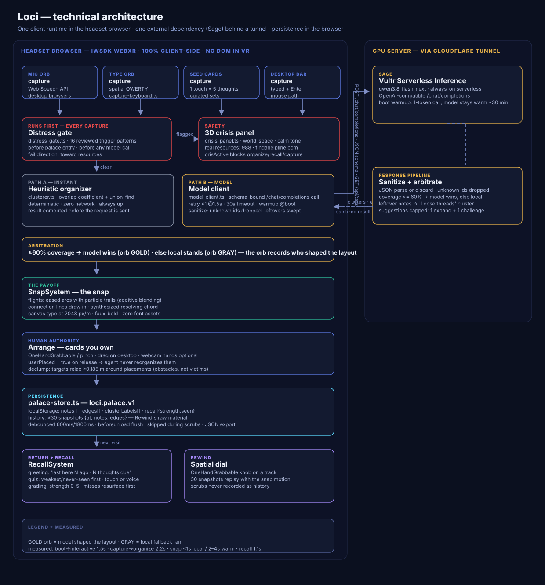

# Loci — a spatial memory bank for Meta Quest

[](https://github.com/0xv3nm09/loci-memory-bank/actions/workflows/deploy.yml)


**Loci is a memory palace you build with your hands.** Dump scattered thoughts
into a calm 3D void; an AI organizer (Sage) snaps them into connected clusters
you can grab, rearrange, and — the part no flat screen can do — **rewind through
your own mind's history**. Come back tomorrow: the palace persists exactly as
you left it, and Recall quizzes your weakest notes with spaced repetition so
the ideas actually stick.

<p align="center">
  
</p>

Entry for the **Meta VR Start Developer Competition 2026** — Productivity track,
New Experience division. Built with the
[Immersive Web SDK](https://developers.meta.com/vr/documentation/iwsdk/guides/overview)
(Meta's Three.js + ECS framework): hands-first, seated, under ten minutes a
session.

**Docs:** [Architecture & data flow](docs/ARCHITECTURE.md) ·
[Diagram set](docs/DIAGRAMS.md) · [Evidence map](docs/EVIDENCE.md) (criteria →
proof) · [Sage model card](docs/MODEL_CARD.md) · [Safety design](docs/SAFETY.md) ·
[How AI was used](docs/AI.md) (in the product + in the build) ·
[Build feedback](docs/FEEDBACK.md) (every issue faced and its fix) ·
[Competition strategy](COMPETITION_STRATEGY.md) · diagrams in [docs/diagrams/](docs/diagrams/)

## How the system connects

<p align="center">
  
</p>

One TypeScript app runs entirely inside the headset's browser. The only
external dependency is **Sage** — a qwen3:14b model served from the
developer's own GPU box over an HTTPS tunnel, called directly with a
JSON-schema-constrained contract. If that box is unreachable, a deterministic
organizer built into the app answers instantly and the organize orb turns
gray: **the agent degrades; the product doesn't.**

<p align="center">
  
</p>

| Capability | How Loci does it |
| --- | --- |
| **Capture** | Four equal paths: speak (mic orb, Web Speech), type (spatial QWERTY keyboard in-headset), seed cards (one touch spills a set), or the desktop bar |
| **Organize** | Sage clusters notes and returns clusters, cross-cluster edges and up to two expand/challenge suggestions — schema-enforced, retried once, sanitized; a deterministic organizer answers instantly on any failure |
| **The snap** | Cards arc into clusters with particle trails, connection lines draw in, a synthesized chord resolves — no audio assets, all WebAudio |
| **Arrange** | Pinch-grab (VR) or drag (desktop); `userPlaced` cards are never reorganized by the agent |
| **Persist** | Autosaved palace in localStorage: layout, per-note memory strength, 30 history snapshots; JSON export |
| **Recall** | Quiz panel generated from real palace data, weakest notes first; answers by touch or voice; strengths reschedule tomorrow |
| **Rewind** | A grabbable dial scrubs the palace through its own history with the snap animation |
| **Safety** | A reviewed trigger list gates every capture before the model or the palace; flagged captures open a 3D crisis panel with real resources and a calm tone |

Full detail: [docs/ARCHITECTURE.md](docs/ARCHITECTURE.md) (systems, data flow,
sequences) · [docs/MODEL_CARD.md](docs/MODEL_CARD.md) (Sage: contract, measured
latencies, limits) · [docs/SAFETY.md](docs/SAFETY.md) (the gate and the panel).

## Two surfaces, one idea

| Surface | What it is | Where |
| --- | --- | --- |
| **Quest app** (primary) | The full hands-first VR experience — this repository's root, deployed to GitHub Pages | this folder |
| **Web companion** | The phone/desktop **Lovable-designed** web version: opening story, per-mode palaces, Recall, Rewind, safety gate — same loop, flat screen | [`web/`](web/README.md) |

The web companion's design originates from [Lovable](https://lovable.dev) and
lives in [`web/`](web/README.md) — see its README to run it (Bun) and
[`web/WEB_VERSION.md`](web/WEB_VERSION.md) for how it relates to the Quest app.

## For judges — run it in 60 seconds

The submitted experience is the **Quest app**. Three ways in:

1. **Quest browser (the real thing):** open the GitHub Pages URL from the
   submission form — hands-first, pinch to grab, orbs to organize.
2. **Desktop with VR emulation:** `npm install && npm run dev` → the IWSDK dev
   window opens with Meta's IWER emulator — controllers map to WASD/mouse.
3. **Desktop, mouse or webcam hands:** any static server on `dist/` — the HUD,
   drag-arranging, and optional webcam hand tracking (via MediaPipe, frames
   never leave the machine) all work without a headset.

All three run the same build. No keys, no accounts, no cloud signup.

## At a glance

- ✅ **Hands-first end to end** — every interaction is pinch, grab, gaze or touch; controllers optional
- ✅ **Real model with a safety net** — schema-constrained qwen3:14b, one retry, instant local fallback; the orb's gold/gray glow says which ran
- ✅ **Verified colorblind-safe palette** — searched under deutan/protan/tritan simulation; worst pair distance 72.2 (the previous palette collapsed to 1.4)
- ✅ **Spaced repetition + persistent palace + 30-snapshot Rewind** — the return loop is mechanics, not notifications
- ✅ **Safety gate before everything** — flagged captures never reach the model or the palace
- ✅ **Zero runtime assets** — canvas-rendered type, synthesized audio, bundled OFL font; loads fast on Quest
- ⚠️ **Voice capture is desktop-only** — Quest browsers have no Web Speech API; typed capture and the spatial keyboard are the equal first-class paths (documented, not hidden)

## Layout

```
src/
  index.ts            World bootstrap, system registration, 72fps/foveation
  loci/
    capture-system    capture paths, seed sets, HUD wiring
    organize-system   model-first arbitration, declump, cluster labels, buds
    snap-system       flights, particle trails, connection lines
    recall-system     quiz panel generation, voice answers, grading
    rewind-system     spatial dial, snapshot scrubbing
    crisis-panel      3D safety surface (blocks everything while open)
    capture-keyboard  spatial QWERTY for in-headset typing
    webcam-hand-sys   MediaPipe hand tracking for desktop testing
    model-client      schema-bound Ollama client, retry, warmup
    clusterer         deterministic fallback organizer
    distress-gate     reviewed trigger list (runs before everything)
    palace-store      versioned save schema, snapshots, export
    text-label        canvas-rendered type (1536px/m, faux-bold)
    palette           design tokens incl. the verified CVD accents
public/               bundled Inter font (OFL), generated welcome panel
COMPETITION_STRATEGY.md  per-category competition strategy
docs/diagrams/         SVG flow diagrams (system, sequences)
docs/                 architecture, evidence map, model card, safety, feedback
```

## Development

```bash
npm install
npm run dev        # IWSDK dev server + in-browser XR emulation (IWER)
npm run build      # production build → dist/
npm run typecheck
cd web && bun install && bun run test   # web companion suite (16 tests)
```

Deployed to GitHub Pages on every push to `main` (`.github/workflows/deploy.yml`).
The `web/` companion is not auto-deployed. A self-hosted mirror of the Quest
build runs on a Vultr VM with Caddy auto-HTTPS:
**https://139-84-174-127.sslip.io** — deploy/update with
`bash scripts/vultr_deploy.sh` (runbook: [docs/DEPLOY-VULTR.md](docs/DEPLOY-VULTR.md)).

## Roadmap

- On-device model option (WebLLM) so Sage needs no server at all
- Cloud palace sync across devices
- Rewind across weeks with month-level grain
- Voice capture on Quest via Meta's Voice SDK (Quest browsers lack Web Speech)

## Privacy note

Thoughts are processed on your device and, for AI organizing, by a small model
on the developer's own server — nothing stored, nothing shared. Optional webcam
hand tracking processes frames entirely on-device via MediaPipe. The palace
lives only in your browser; export it anytime.

## License

MIT for app code; bundled Inter font under the SIL OFL (`public/fonts`).
