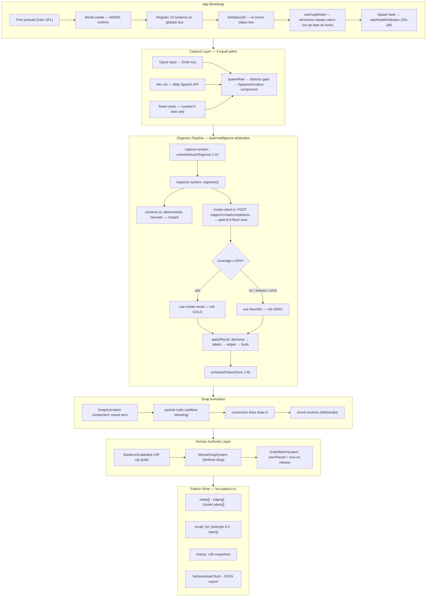

# 1. Best New Productivity Experience (our track)

> **Eligibility:** the track prize Loci is entered under. The track asks for
> "apps for effectiveness anywhere or recurring daily contexts (workspaces,
> task management, creative tools, routines)" — hands-first implementation
> required, seated-friendly.

## The claim in one line

Loci is a **daily thinking ritual** — dump scattered thoughts, watch Sage
snap them into a constellation, arrange them with your hands, come back
tomorrow and recall what stuck — designed around how memory actually works
(method of loci + spaced repetition), not a task list ported into VR.

## What the judges reward

- Built around a **recurring daily moment** (morning mind-dump, weekly planning)
- **Hands-first** interaction — not adapted from a flat workflow
- Seated, comfortable, limited movement
- Real effectiveness: the tool must actually help, not demo well

## How Loci covers it

### 1. A recurring ritual, not a feature list

The core loop is engineered to be repeatable daily: capture (any of four
paths) → the snap (Sage organizes) → arrange (human authority) → return
(welcome-back greeting + Recall scheduling). Every stage feeds the next
day's session — the palace you arrange today is the quiz you take tomorrow.

### 2. Grounded in cognitive science, not gamification

The method of loci (2,000+ years old) says memory needs a place; spaced
repetition says review should be scheduled by performance. Loci implements
both literally: thoughts occupy positions in a persistent 3D palace, and
per-note strength (0–5) schedules what comes back first. No streaks, no
guilt mechanics — the schedule does the motivating.

### 3. Comfortable by design (criterion 3: FoV-aware design)

- **Comfortable-FoV clamp** (`layout.ts clampToComfortableFoV`): cluster
  centers and new spawns stay inside a ±30° horizontal cone (60° total) and
  a 1.05–1.45 m seated height band — inside every Quest device's narrower
  FoV, no neck strain
- **Gaze-assisted focus** (`ambient-system.ts`): the card you look at lifts
  1.04× with a glow whisper + soft tick — the interface answers your
  attention before your hand moves
- Seated two-foot arc for all affordances, `locomotion: false`

### 4. Dual-intelligence organize that never stalls

Instant deterministic heuristic held ready → schema-constrained model call
(qwen3.8-flash-next via the keyless `/sage` proxy) → model must cover ≥60%
of notes to win → gold/gray orb records which ran. Effectiveness never
depends on a network being up.

## Implementation map

| File | Role in the loop |
| --- | --- |
| `capture-system.ts` | Typed, voice (Web Speech), seed sets, spatial keyboard; `restorePalace` return greeting; `scheduleAutoOrganize` 2.2 s |
| `distress-gate.ts` | Safety gate before anything else sees a thought |
| `organize-system.ts` | Dual-path arbitration, declump, cluster labels, suggestion buds |
| `model-client.ts` | Schema-bound Sage client via same-origin `/sage` proxy; retry ×1; sanitization |
| `clusterer.ts` | Deterministic fallback organizer (token overlap + union-find) |
| `snap-system.ts` | Eased flights, particle trails, connection lines |
| `mouse-drag-system.ts` + `DistanceGrabbable` | Human arrangement (desktop + VR) |
| `GrabWatchSystem` | `userPlaced = true` — Sage never reorganizes your placements |
| `palace-store.ts` | Versioned save, debounced writes, beforeunload flush, JSON export |
| `recall-system.ts` | Weakest-first quiz, voice answering, strength grading |
| `layout.ts` | Grid layout, declump relaxation, comfortable-FoV clamp |

## Evidence you can verify

- **Live:** capture on the hosted link → snap lands in <1 s local / 2–4 s
  with Sage warm; arrange a card → re-organize never moves it
- **Measured:** boot→interactive 1.5 s; capture→auto-organize 2.2 s;
  Recall panel 1.1 s; declump minimum pair distance 0.185 m (measured in XR)
- **Proof frames:** [README "Proof it works"](../../README.md#proof-it-works--real-frames)
  (hosted app organize + Recall; phone/desktop companion)
- **Tests:** Quest suite 13/13, web companion 16/16

## Diagrams

## Demo & Devpost talking points

- Open with the ritual, not the menu: "dump three thoughts → snap → grab one
  → tomorrow it quizzes you."
- Name the science once: "method of loci + spaced repetition — the technique
  is ancient, the place is finally real."
- Show the comfort story: seated, everything within arm's reach, layout
  clamped to a natural viewing cone.
- Close on persistence: close the app, reopen — greeting with due count.

## Honest limits for this category

See [09-documented-limits.md](09-documented-limits.md) — voice capture is
desktop-only (Quest keyboards are the equal path there), and the web
companion is a flat-screen companion, not the submission surface.
