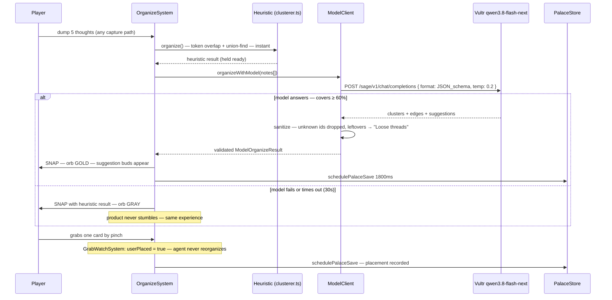
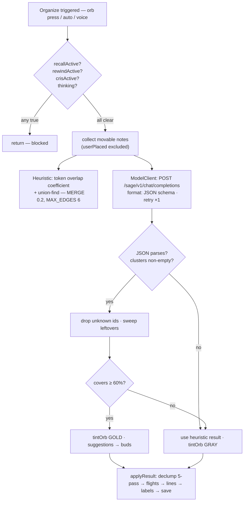

# 2. Best Agentic Interaction

> **Eligibility:** special award — "AI as a core part of the experience:
> context-aware assistance, autonomous analysis, transparent agent
> behavior."

## The claim in one line

Sage is a **real agent whose agency is visible and honest**: it analyzes
your thoughts, structures them, offers suggestions — and the interface
always tells you exactly which intelligence shaped what you see.

## What the judges reward

- AI woven into the core loop (not a bolted-on chatbot)
- **Autonomous analysis** that does real work
- **Transparent behavior** — the user can always tell what the agent did
- Graceful behavior when the AI is unavailable

## How Loci covers it

### 1. Sage does real analytical work

Every organize sends your notes to a schema-constrained model
(`qwen3.8-flash-next` via Vultr Serverless Inference) that returns:
thematic **clusters**, up to 6 **cross-cluster edges** with two-word
reasons ("same deadline"), and up to 2 **suggestions** — one *expand*
(an inviting question about a thin note) and one *challenge* (an honest
question pressing on a weak or contradictory note). Suggestions are offers,
never instructions.

### 2. Agency is visible — the gold/gray orb

The organize orb's tint records which intelligence shaped the current
layout: **gold = the model organized it**, **gray = the local fallback
did**. One glance answers "did the AI do this?" — no guesswork. Status
messages are equally honest ("Sage organized your thoughts." / "Sage
couldn't reach the model — organized locally instead.").

### 3. Model-exclusive evidence

Suggestion buds are structurally impossible for the fallback organizer
(`clusterer.ts` has no suggestions field) — so **every bud on screen is
visible proof of agency**. Buds are pressable: the text bubble pins open.

### 4. Retry-then-fallback — the product never stumbles

The heuristic result is computed *before* the request fires; the model has
30 s, one retry, strict JSON validation, ID sanitization (unknown ids
dropped, leftovers swept into a "Loose threads" cluster), and must cover
≥60% of notes to win. If Sage is unreachable, the snap still happens —
same experience, gray orb.

### 5. Secret-safe agent plumbing (criterion 3: platform craft)

The model call runs through a **same-origin `/sage` proxy**: the VM's Caddy
injects the Authorization header server-side, restricted to requests the
app itself sends. The client bundle contains no key, ever — verified by a
deploy-time gate that refuses a keyed bundle.

### 6. Voice answers in Recall

`answerByVoice()` fuzzy-matches a spoken transcript to the quiz's option
bars (substring + word-overlap scoring) — the agent conversation extends
to grading.

## Implementation map

| File | Role |
| --- | --- |
| `model-client.ts` | Schema-bound client: system prompt, `response_format: json_object`, 30 s timeout, retry ×1 @1.5 s, strict sanitization, same-origin proxy path |
| `organize-system.ts` | `applyBest` arbitration (≥60% coverage rule), `tintOrb` gold/gray, bud creation at post-snap positions |
| `clusterer.ts` | Fallback organizer — deliberately has **no suggestions field** |
| `recall-system.ts` | `answerByVoice` spoken-answer matching |
| `scripts/vultr_deploy.sh` | Server-side key injection (Caddy), Origin-checked `/sage/*` route, refuses to ship a keyed bundle |

## Evidence you can verify

- **Live:** press Organize → orb turns **gold**, two buds appear, edges
  carry reasons; the status line names the organizer
- **Fail-safe demo:** block the proxy → orb turns **gray**, the snap still
  lands, buds absent (they're model-exclusive)
- **Bundle check:** the deployed JS contains no API key (deploy gate +
  grep-verified); `/sage` without the app's Origin → 404
- **Tests:** Quest suite 13/13 (covers organize arbitration paths)

## Diagrams

## Demo & Devpost talking points

- "Watch the orb: gold means Sage organized this; kill the network and it
  goes gray — same experience, zero waiting."
- "Every green/amber bud on screen could only come from the model — the
  fallback structurally cannot produce one."
- "The agent never touches cards you placed by hand — your arrangement is
  authority."
- Privacy angle: notes go to a schema-constrained endpoint; the distress
  gate runs *before* any model call, and flagged captures never reach it.

## Honest limits for this category

Sage analyzes only what you captured (no external data); the model is a
cloud call (on-device WebLLM is on the roadmap); suggestions are capped at
two per organize by design.
