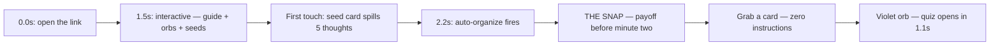
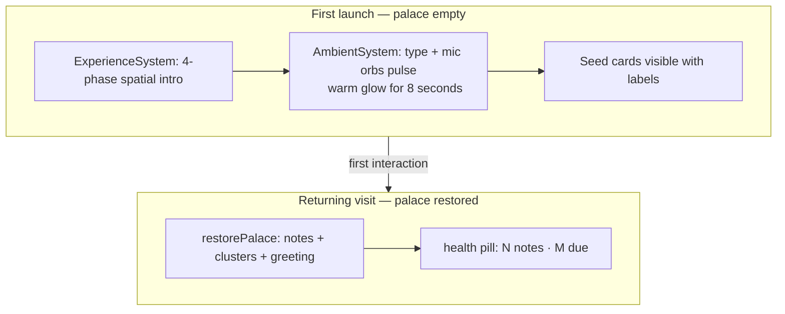

# 3. Best First Five Minutes

> **Eligibility:** special award — "how fast the experience explains
> itself, teaches interaction without a wall of text, and delivers a
> payoff."

## The claim in one line

Boot to interactive in **1.5 s**, first capture on the first touch,
**THE SNAP** payoff before minute two — taught by a narrative intro, never
a tutorial wall.

## What the judges reward

- Instant comprehension: what is this, what do I do
- Teaching through doing, not text
- A memorable payoff early
- No dead time, no login walls, no configuration

## How Loci covers it

### 1. The timed opening (measured on the built app)

| t | What happens |
| --- | --- |
| 0.0 s | Link opens — splash reads "Making room for your thoughts…" |
| **1.5 s** | Interactive: calm void, orbs, seed cards, in-scene status |
| ~10–40 s | 4-phase narrative intro ("Welcome to Loci…") — skippable, one press |
| First touch | A seed card spills 5 themed thoughts — capture without typing |
| **+2.2 s** | Auto-organize fires (no button hunting) |
| **<1 s later** | **THE SNAP**: flights, particle trails, connection lines, resolving chord |
| Any time | Grab any card — zero instructions needed; violet orb opens Recall in 1.1 s |

### 2. Discovery mechanics, not menus

- **First launch:** the ExperienceSystem plays the spatial intro; the type
  and mic orbs pulse warm for the first 8 seconds (discovery pulse); seed
  cards are visible and labeled
- **Returning visit:** `restorePalace` rebuilds everything with a
  welcome-back greeting ("last here 3 hr ago — 4 thoughts due") — the
  first five minutes of a *returning* user are also designed
- **No accounts, no keys, no setup:** the link *is* the onboarding

### 3. Teaching without text

Every affordance is labeled in-scene (canvas-rendered type), every orb is
glyphed, hover lifts + glows, gaze focus lights the card you're looking at
— the environment teaches by responding. The spatial keyboard, seed sets,
and one-press organize mean the first successful *loop* happens in about
90 seconds.

### 4. Comfort from the first frame

New thoughts spawn inside the comfortable-FoV clamp (±30° cone, seated
band) — the first thing a new user learns is that nothing will ever ask
them to turn their neck.

## Implementation map

| File | Role |
| --- | --- |
| `experience-system.ts` | 4-phase spatial intro, discovery pulse wiring, guide/help |
| `capture-system.ts` | Seed sets, `spawnRaw`, `scheduleAutoOrganize` (2.2 s) |
| `organize-system.ts` + `snap-system.ts` | The snap: flights, trails, lines, chord |
| `layout.ts` | Grid + declump so the first organize never overlaps; FoV clamp |
| `note-factory.ts` | Spawn animation (scale overshoot, glow bloom, shimmer tone) |
| `onboarding.ts` / `guide.ts` | First-launch walkthrough (localStorage-gated), welcome panel |

## Evidence you can verify

- **Measured:** boot→interactive **1.5 s** (desktop, warm cache); Recall
  panel open **1.1 s**; snap **<1 s** local, 2–4 s Sage warm
- **Proof frame:** [README — hosted app welcome +
  organize](../../README.md#proof-it-works--real-frames) shows the intro
  and the organized palace a new user reaches in minutes
- **No dead ends:** every first-run path (empty palace, no mic, VR-less
  desktop) lands in a working state — VR-less browsers get a guide panel
  instead of a dead button

## Diagrams

## Demo & Devpost talking points

- Record the timer: "link → first thought → snap — under two minutes,
  no tutorial."
- Point at the seed cards: "capture without typing a word."
- Emphasize skip-ability: "the intro is a story you can skip — the app
  teaches by responding either way."

## Honest limits for this category

The narrated intro adds ~40 s if watched (it is skippable); voice capture
is desktop-only (seed cards + keyboard carry the first minutes on Quest).
