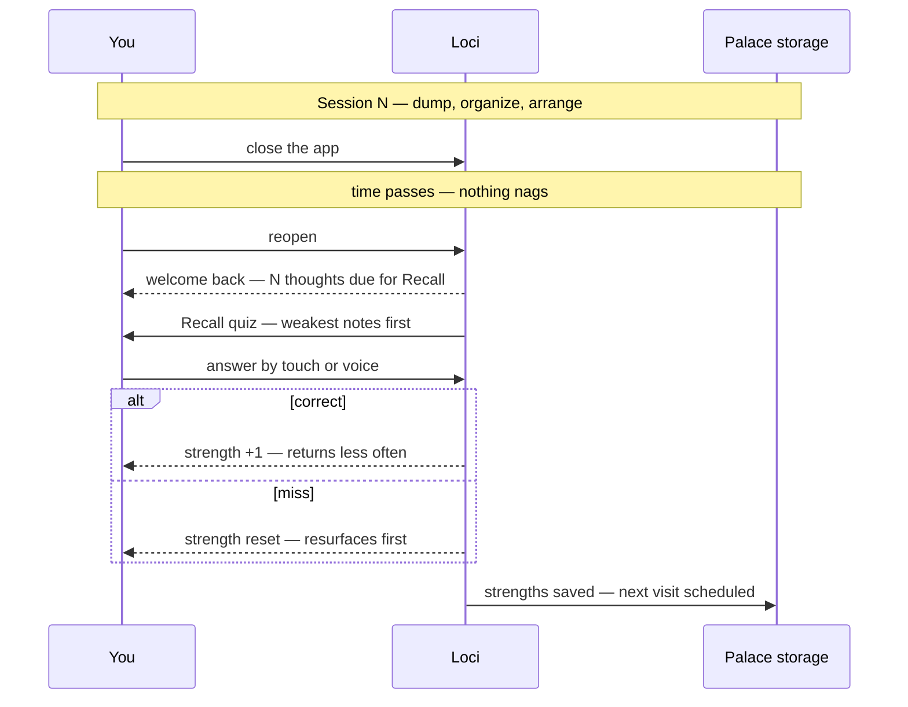
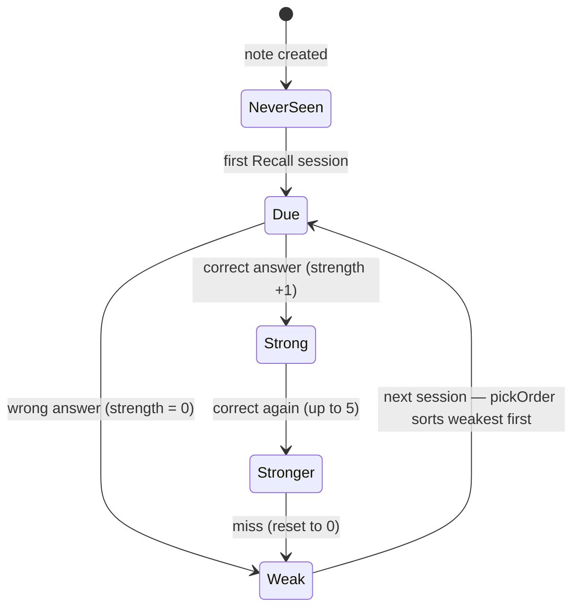

# 4. Best Reason to Come Back

> **Eligibility:** special award — "visible growth between sessions and a
> loop that pulls the user back tomorrow."

## The claim in one line

The return loop is **mechanics, not notifications**: per-note memory
strength, weakest-first scheduling, a palace that persists exactly as you
left it — and Rewind, which lets you scrub your own mind's history through
physical space.

## What the judges reward

- A reason to return that lives in the product (no push, no guilt)
- Visible growth between sessions
- Persistence that respects the user's work

## How Loci covers it

### 1. The greeting that matters — at the moment it matters

`restorePalace` fires a welcome-back line built from the *last save*:
"Welcome back — last here 3 hr ago. **4 thoughts due for Recall.**" The
due count comes from real per-note scheduling, so the first thing a
returning user sees is their own progress, not a marketing message. The
health pill (N notes · M due, refreshed every 30 s) keeps it visible.

### 2. Per-note memory strength — scheduling by performance

- Every note carries `strength 0–5` + last-seen state, persisted in the
  palace save
- `pickOrder()` serves the **weakest / never-seen first** — the schedule is
  built from *your* performance, nothing else
- Correct answer → strength +1 (cap 5), green glow, rising ping
- Miss → strength resets to 0, amber, soft neutral tone (no failure buzz)
- Misses resurface first tomorrow — the product pulls you back by being
  *useful*, not by nagging

### 3. The palace grows — and you can see it grow

- Notes, clusters, edges, and **your own card placements** persist across
  sessions (versioned `loci.palace.v1`)
- The history ledger keeps **≤30 snapshots** of the palace's layout
- **Rewind**: grab the physical dial at the void's edge and scrub your
  mind's history — cards reflow through their past arrangements. Scrubs
  are never recorded as saves (the past can't be overwritten by browsing it)

### 4. Nothing nags

No streaks (deliberately rejected — conflicts with the no-guilt
principle), no push notifications, no countdowns. The return reason is
"your palace is waiting and three thoughts are fading."

## Implementation map

| File | Role |
| --- | --- |
| `palace-store.ts` | Versioned save, `RecallState`, ≤30-snapshot history, debounced writes, beforeunload flush |
| `recall-system.ts` | `pickOrder` (weakest/never-seen first), grading, voice answering |
| `capture-system.ts` | `restorePalace` — greeting with `countDue`, `agoLabel` |
| `rewind-system.ts` | Grabbable dial, snapshot scrubbing, "scrubs never recorded" guard |
| `palace-health.ts` | 30 s health pill (notes + due) |

## Evidence you can verify

- **Two-session test:** day 1 capture + organize + arrange → close → day 2
  open → greeting with due count → quiz serves weakest first → misses reset
- **Proof frames:** [README — Rewind
  history](../../README.md#proof-it-works--real-frames) (hosted app) and
  the [web companion frames](../../README.md#web-companion--one-palace-two-screens)
  (phone Rewind panel — the loop survives on flat screens)
- **Save schema:** JSON export from the ? menu shows `recall` strengths and
  `history` snapshots directly

## Diagrams

## Demo & Devpost talking points

- "Come back tomorrow: the palace is exactly where you left it — and it
  already knows what's fading."
- "The schedule comes from your answers, not a streak. Miss something? It
  comes back first. That's the whole loop."
- "And the part no flat screen can do — grab the dial and scrub through
  your own mind's history."

## Honest limits for this category

Strength is a simple SM-2-lite grade (0–5), not a full spaced-repetition
scheduler; history depth is 30 snapshots; the loop is single-player
(shared palaces are roadmap).
