# 5. Best Accessibility Forward Experience

> **Eligibility:** special award — "voice alternatives for hands,
> high-contrast modes, or experiences inclusive by default."

## The claim in one line

**Inclusive by default, verified rather than claimed:** a colorblind-searched
palette, every input and output channel redundant, gaze + hands + voice +
keyboard all first-class, one hand seated.

## What the judges reward

- Alternatives for every interaction channel
- High-contrast / scalable presentation
- Inclusion engineered in, not bolted on
- Comfort: seated, limited movement

## How Loci covers it

### 1. Colorblind-safe palette — verified, not claimed

The six accent colors were **searched under Viénot deutan/protan/tritan
simulation**: the shipped set has a worst-pair distance of **72.2**; the
original palette collapsed to **1.4** under protanopia (two accents became
indistinguishable). Cluster hues are interleaved warm/cool and mapped 1:1
to the verified accents.

### 2. Every channel redundant — inputs

- **Voice:** mic orb + Web Speech (desktop) + spoken quiz answers
- **Hands:** pinch-grab (Quest) via `useHandPinchForGrab`
- **Typed:** spatial QWERTY keyboard — the equal path on Quest (which has
  no speech API — documented, not hidden)
- **One finger:** seed cards and orbs are one-press
- **Mouse:** full drag + click parity on desktop
- **Gaze:** cards respond to where you look (focus lift + tick) before any
  hand movement is required

### 3. Every channel redundant — outputs

- **Color** is never the only signal: buds carry +/? glyphs, every state
  has a shape or label
- **Audio** cues (chord, ping, calm crisis tone) accompany visual states
- **Text scale:** the Aa orb cycles 100/125/150% live across every label
- **High-contrast mode:** HC button flips HUD + overlays to pure
  black/white
- **Reduced motion** honored via cached `prefersReducedMotion()`

### 4. Comfort: one hand, seated, no neck strain

All affordances sit within a two-foot arc at seated height; `locomotion:
false`; the comfortable-FoV clamp (±30° cone, 1.05–1.45 m band) means no
interaction ever requires head-turning beyond a natural glance.

### 5. Safety that reaches everyone

The crisis panel pairs its message with a calm low tone (presence, not
alarm), uses plain text + real resources, and is dismissible with a single
press.

## Implementation map

| File | Role |
| --- | --- |
| `palette.ts` | CVD-searched accents (worst pair 72.2) |
| `text-label.ts` | Canvas-rendered labels, live Aa scale 100–150% |
| `media-queries.ts` | Cached `prefersReducedMotion()` |
| `speech.ts` / `capture-keyboard.ts` | Voice ↔ typed parity |
| `styles.css` | High-contrast mode, HUD scaling |
| `crisis-panel.ts` + `audio.ts` | Calm tone, accessible safety surface |
| `ambient-system.ts` | Gaze focus + feedback hierarchy (grab > hover > gaze) |
| `layout.ts` | Comfortable-FoV clamp, seated band |

## Evidence you can verify

- **Palette:** verification method + numbers in
  [CAPABILITIES.md](../CAPABILITIES.md#accessibility) (72.2 vs 1.4)
- **Proof frames:** [README — accessibility-visible states across
  hosted app + companion](../../README.md#proof-it-works--real-frames)
- **Keyboard on Quest:** the spatial keyboard exists precisely because
  Quest browsers lack speech recognition — the alternative shipped, not
  promised
- **Tests:** Quest 13/13, web 16/16 (both suites run in CI)

## Diagrams

```mermaid
flowchart LR
  subgraph INPUTS["Input — every channel works alone"]
    I1["Voice: mic orb (desktop)"]
    I2["Hands: pinch-grab (Quest)"]
    I3["Typed: type orb → spatial keyboard"]
    I4["One finger: seed cards + orbs"]
    I5["Mouse: drag + click (desktop)"]
  end
  INPUTS --> GATE["Distress gate → Organize pipeline"]
  GATE --> OUTPUTS
  subgraph OUTPUTS["Output — every signal redundant"]
    O1["Color: CVD-verified palette"]
    O2["Glyphs: + and ? marks on buds"]
    O3["Audio: chord, ping, calm tone"]
    O4["Text scale: Aa orb 100-150%"]
    O5["HC mode: pure black/white"]
  end
  OUTPUTS --> USER["Same experience regardless of
  which channel or ability"]
```

## Demo & Devpost talking points

- "The palette was searched under three colorblindness simulations — the
  first version failed badly, so we searched for one that doesn't."
- "No interaction needs two hands, standing, or hearing: one finger, one
  hand, seated — voice, keyboard, and gaze are all first-class."
- "Turn on HC mode live: pure black and white, nothing else changes."

## Honest limits for this category

No localized languages yet (English in-scene text); Web Speech recognition
quality varies by accent (typed capture is the fallback); audio cues are
subtle by design (visual redundancy carries them).
