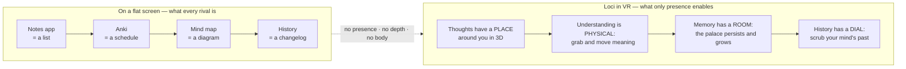

# 6. Boldest Original Concept

> **Eligibility:** special award — "an idea whose core loop depends on
> presence, spatial depth, or hands — one that would fall apart on any
> other platform."

## The claim in one line

**Loci falls apart off-platform.** Thoughts have a place, understanding is
physical, memory has a room, history has a dial — remove presence, depth,
or hands and there is no product.

## What the judges reward

- A concept only possible in VR (not a flat app with depth added)
- Creative ambition: a new interaction grammar
- The courage of a core loop that *requires* the medium

## How Loci covers it

### 1. Every flat-screen analogue is a downgrade

A notes app becomes a list. Anki becomes a schedule. A mind map becomes a
diagram. Version history becomes a changelog. In Loci those are *places
and objects*: thoughts float around you in 3D, you grab and move meaning
with your hands, the palace persists as a room you revisit, and your
mind's history is a **physical dial you scrub through**.

### 2. The Rewind dial — the beat no flat screen can imitate

Thirty snapshots of your palace, scrubbed by grabbing a knob at the void's
edge: cards reflow through their past arrangements while you watch. On a
flat screen this is a slider over screenshots; in VR it is standing inside
your own memory while it rewinds. This is the boldest single beat in the
product and the demo's closer.

### 3. Presence-dependent learning

The method of loci requires an imagined place; VR supplies a real one.
Spatial memory (where a thought *lives*) becomes a retrieval cue the same
way physical locations do — the core loop (organize → place → walk through
→ recall) depends on depth, scale, and hand presence to function at all.

### 4. Comfort keeps the boldness humane

Bold doesn't mean disorienting: the FoV clamp, seated two-foot arc, no
locomotion, and gaze-responsive cards keep the ambitious loop comfortable
enough to do daily.

## Implementation map

| File | Role |
| --- | --- |
| `rewind-system.ts` | The spatial dial: ≤30 snapshots, grabbable knob, "scrubs never recorded" |
| `organize-system.ts` + `layout.ts` | Spatial structure: clusters as places in the room |
| `snap-system.ts` | The snap — motion that reads as thoughts *becoming* structure |
| `ambient-system.ts` | Gaze-responsive cards — the space answers attention |
| `docs/diagrams/boldest-collapse-flow.svg` | The collapse test, drawn |

## Evidence you can verify

- **Collapse test (in the demo video):** show the same actions on a phone —
  capture works, recall works, but "where does this thought live?" and
  "scrub the room's history" lose their meaning entirely
- **Proof frame:** [README — emulator Rewind
  scrub](../../README.md#proof-it-works--real-frames) (controller on the
  dial, history counter visible)
- **Shipped, not sketched:** Rewind is fully implemented (snapshot reflow,
  now-button, never-recorded guard)

## Diagrams

## Demo & Devpost talking points

- "Try to do this on a phone — capture survives, but the palace, the
  walk-through, and the dial simply stop meaning anything."
- "Two thousand years ago, orators imagined places to remember speeches.
  This is the first medium where the place is real."
- End the demo on the Rewind dial, hands on the knob.

## Honest limits for this category

The palace is one room (multiple rooms are roadmap); the dial covers 30
snapshots, not weeks of grain.
