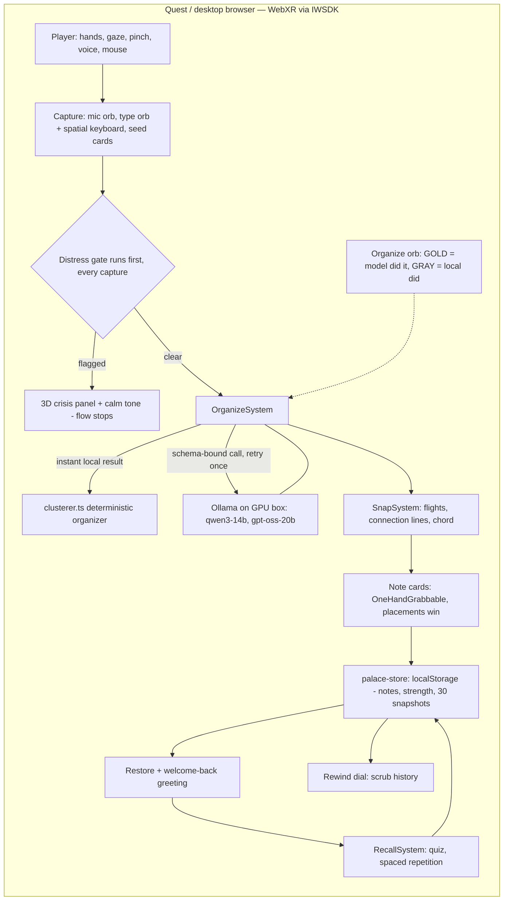

# Prize targeting — index

One file per category we are targeting. Each documents: what the judges
reward (from the official criteria), what is already built (with file
references), the **exact flow sequence** to show on camera, and status.

| File | Category | Prize | Status |
|---|---|---|---|
| [productivity-track.md](productivity-track.md) | Best New Productivity Experience (primary) | $70,000 (+$35K runner-up) | Core complete |
| [best-agentic-interaction.md](best-agentic-interaction.md) | Best Agentic Interaction | $25,000 | Complete + visibility fix |
| [best-reason-to-come-back.md](best-reason-to-come-back.md) | Best Reason to Come Back | $25,000 | Complete + return greeting |
| [best-first-five-minutes.md](best-first-five-minutes.md) | Best First Five Minutes | $25,000 | Timed walkthrough documented |
| [best-accessibility-forward.md](best-accessibility-forward.md) | Best Accessibility Forward | $25,000 | Verified palette + text scale |
| [boldest-original-concept.md](boldest-original-concept.md) | Boldest Original Concept | $25,000 | Pitch-only (no code) |

Track: **Productivity** · Division: **New Experience**. One entry competes
for the track prize and every special award it fits — no extra submission
work beyond what each file's flow sequence shows on camera.

## Master system map — how everything is connected

The app runs entirely in the headset's browser (IWSDK/WebXR). The only
external dependency is Sage: your GPU box running Ollama (qwen3:14b) over an
HTTPS tunnel — called directly, no backend, schema-constrained. If that box
is off, the deterministic organizer inside the browser answers instantly and
the orb turns gray. The palace lives in the browser's local storage: notes,
layout, per-note memory strength, and 30 history snapshots backing Rewind.

*Real case: GPU box asleep → the gray path keeps the whole product working;
judges never see a failure state.*
