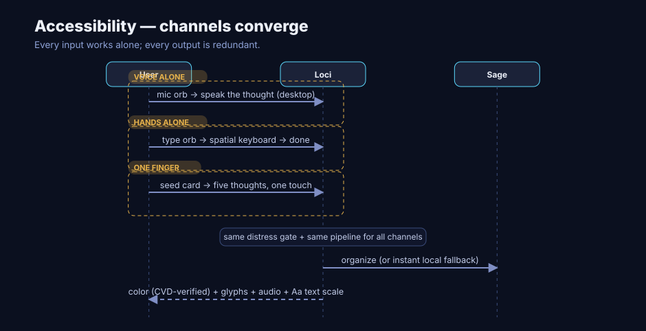
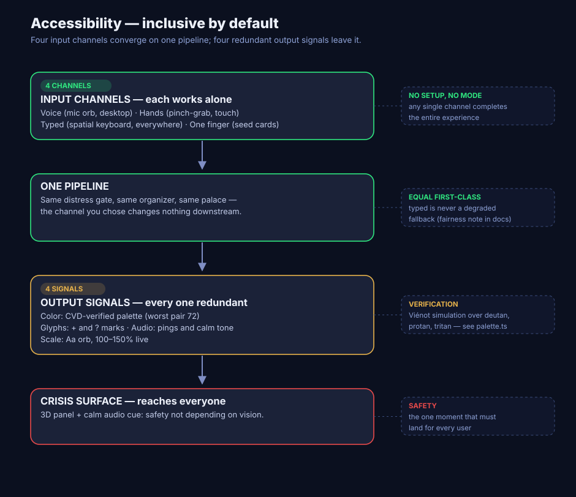

# Best Accessibility Forward Experience — $25,000

**Judges reward:** "Accessible XR design — voice alternatives for hand
interactions, eyes-only navigation for limited mobility, high-contrast modes,
or experiences inclusive by default."

## Why Loci wins it

Inclusive by default was a design constraint, not a mode:

1. **Voice and hands each work alone.** Capture: voice (mic orb; desktop browsers — Quest browser does not yet ship SpeechRecognition, so on headset the keyboard path covers this) →
   spatial keyboard (everywhere) → seed cards (one touch). Answers: touch or
   spoken. Nothing requires both channels at once (`speech.ts`,
   `capture-keyboard.ts`).
2. **Cluster colors are *verified* colorblind-safe, not claimed.** The six
   accents (`palette.ts`) were searched under Viénot deuteranopia /
   protanopia / tritanopia simulation to a minimum pairwise distance of 72
   (~60+ reads distinct; the previous palette collapsed to **1.4** under
   protanopia). `accentForHue()` maps every stored hue to the nearest safe
   accent, so all palaces — old and new — render safely.
3. **Meaning is never color-only.** Expand/challenge buds carry **+** / **?**
   glyphs (the art direction's own rule); recall grading pairs color with
   position and tone; low-confidence items dim rather than redden.
4. **Global text scaling.** The green **Aa orb** cycles 100 → 125 → 150%
   (`text-label.ts` `setTextScale`, applied live to every label in the scene
   via traversal; new labels inherit it at creation).
5. **Single-hand, seated, no locomotion.** Every interactive entity is
   `RayInteractable` and/or `OneHandGrabbable` — no two-hand-only interaction
   anywhere in the codebase; the whole experience fits a two-foot radius.
6. **Safety that speaks.** The crisis panel — the one surface that must
   always land — now has its own deliberately calm audio cue
   (`audio.ts` `playCalmTone()`), so the safety moment reaches users who
   can't rely on vision alone.
7. **Spatial memory aids neurodivergent learners by design** — the product's
   core mechanic *is* the accessibility feature (method of loci).

## What is built (file references)

| Capability | Where |
|---|---|
| CVD-verified palette + rationale | `palette.ts` `CLUSTER_ACCENTS` |
| Hue→accent mapping (old saves safe) | `palette.ts` `accentForHue()` |
| Text-scale orb + live traversal | `capture-system.ts`, `text-label.ts` |
| Webcam hand tracking | Desktop pinch-to-grab without VR headset | `webcam-hand-system.ts` |
| Spawn tone | Non-visual audio feedback when a thought materializes | `audio.ts` (`playSpawnTone`) |
| Spatial keyboard (voice alternative) | `capture-keyboard.ts` |
| Voice capture + voice answers | `speech.ts`, `recall-system.ts` |
| Crisis calm tone | `audio.ts` `playCalmTone()`, `crisis-panel.ts` |
| Glyphs with every color signal | `note-factory.ts` buds, `recall-system.ts` |
| One-hand-only interaction | `note-factory.ts` (`OneHandGrabbable` only) |

## The flow sequence

1. **Open on the orb row.** Narrate: "keyboard or hands or one finger — every
   path works alone."
2. **Capture without hands:** mic orb → speak a thought (desktop). Then
   capture without voice: **type** orb → spatial keyboard → done.
3. **Press the Aa orb twice** — the whole scene's text grows to 150% live.
   Say: "one touch, everything readable."
4. **Organize, then point at two clusters:** "these two colors collapse for
   colorblind users in most apps — ours were *searched* under three kinds of
   color blindness to stay distinct." (Show `palette.ts` comment for one
   second if the video tolerates it.)
5. **Recall answered three ways:** touch a bar · say the answer · (hands-only
   on Quest). "Three channels, zero setup."

## Video guidance

Accessibility demonstrations fail when they feel like a settings tour — keep
it woven into the main flow: use voice once, keyboard once, Aa once, and let
the palette verification be a confident sentence, not a lecture.

## System flow — redundant channels in, redundant signals out (flowchart)

*Figure: each framed row is an input channel working alone; they all land
in the same gate and pipeline.*

*Figure: the flow view — including the CVD verification note and the
crisis surface that reaches users who cannot rely on vision.*

