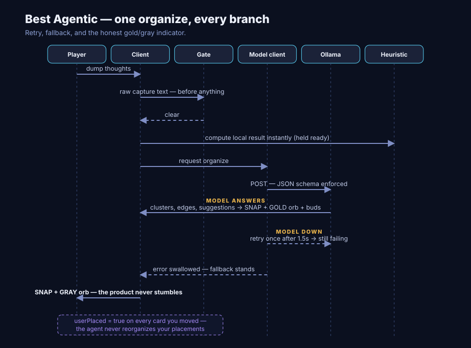

# Best Agentic Interaction — $25,000

**Judges reward:** "Apps where AI is a core part of the experience — spatial
agents, voice-first AI interaction, procedural content, context-aware
assistance."

## Why Loci wins it

Sage is not a chatbot bolted on — it is the organizing intelligence of the
space, and its agency is **visible, safe, and honest**:

- **Real model, structured output.** Every organize asks qwen3:14b through a
  JSON-schema-constrained call (`model-client.ts`); it returns clusters,
  cross-cluster edges, and up to two suggestions (one expand, one challenge)
  phrased as the model's own questions.
- **Retry, then graceful autonomy.** `organizeWithModel()` retries once after
  a tunnel blip; if the model is truly unreachable, the deterministic local
  organizer answers instantly (`clusterer.ts`). The user is never blocked —
  the *agent degrades, the product doesn't.*
- **The gold/gray orb tells the truth.** After every organize, the orb stays
  **gold** if the model shaped the layout, **gray** if local fallback did —
  a persistent, at-a-glance record of which intelligence acted
  (`organize-system.ts` `tintOrb`).
- **Suggestion buds are model-exclusive.** The heuristic *cannot* produce
  them (`OrganizeResult` has no suggestions field) — so every green **+** /
  amber **?** bud on screen is visible proof the agent contributed something
  beyond determinism.
- **The agent proposes; you dispose.** Nothing auto-applies. Notes you moved
  by hand are never reorganized (`userPlaced`), and the distress gate runs
  before Sage ever sees a capture (`distress-gate.ts`).

## What is built (file references)

| Capability | Where |
|---|---|
| Schema-constrained model calls + retry | `model-client.ts` |
| Deterministic fallback organizer | `clusterer.ts` |
| Fallback-first arbitration (≥60% coverage rule) | `organize-system.ts` `applyBest()` |
| Gold/gray agent-status orb | `organize-system.ts` `tintOrb()` |
| Expand/challenge suggestion buds | `organize-system.ts`, `note-factory.ts` `createSuggestionBud` |
| Voice capture + voice quiz answering | `speech.ts` (shared recognizer API) + `capture-system.ts` (voice capture) + `recall-system.ts` `answerByVoice()` |
| Safety gate before the model | `distress-gate.ts`, `crisis-panel.ts` |
| Boot-time model warmup | `model-client.ts` `warmupModel()` |

## The flow sequence

1. **Dump five mixed thoughts** (seed card or voice). Cards land scattered.
2. **Touch the organize orb.** Status: "Sage is reading your thoughts…" —
   the thinking beat is honest work, not fake latency.
3. **The snap.** Clusters form; the orb turns **gold** — point at it: "gold
   means the language model did this."
4. **Look for the buds.** A green **+** next to a thin note ("want me to take
   this further?") and an amber **?** next to a weak one. Tap one: the
   model's own question appears. That text was generated by qwen3:14b — the
   local organizer structurally cannot produce it.
5. **The resilience beat (record this deliberately):** with the camera
   rolling, the operator stops the GPU box → organize again → status flips
   to "organized locally" and the orb turns **gray** — the app never
   stumbles. Restart the box → gold returns. *This is the strongest agentic
   beat in the demo: autonomy with visible honesty.*
6. **Voice answer (desktop):** in Recall, just say the answer — the panel
   selects it. Voice-first agentic interaction, no menus.

## Video guidance

The criteria name "context-aware assistance" — the suggestion buds and the
gold/gray orb are exactly that, made visible. Give the resilience beat its
own five seconds; judges reward agents that fail honestly.

## System flow — one organize, every branch (sequence)

*Figure: the two framed boxes are the real-case branches — MODEL ANSWERS
(gold orb, buds) and MODEL DOWN (retry, gray orb). Either way the snap
lands and the note at the bottom holds: your placements are never touched.*
*The buds are model-exclusive: the heuristic structurally cannot produce
them — every bud on screen is visible proof the agent contributed.*

