# Best First Five Minutes — $25,000

**Judges reward:** "How fast the experience explains itself, teaches
controller-free interaction without a wall of text, and delivers a payoff
before the user takes the headset off."

## Why Loci wins it

- **First action inside one minute.** The void opens with a generated
  6-step guide panel (from `guide.ts`), four labeled orbs at seated chest
  height, and three seed cards — the seed card is the "one touch, big
  payoff" path: press once, five thoughts spill, the snap happens 2.2
  seconds later with zero learning.
- **The payoff (the snap) lands before minute two** on the seed path.
- **No wall of text.** Onboarding is six short lines, diegetic, in-world;
  the status line teaches in one sentence at a time.
- **Controller-free by default.** Everything is gaze/pinch or touch; the
  desktop mirror exists for development.

## Measured walkthrough (desktop browser, mouse — the timings to beat)

Measured on the built app served locally; steps driven by real clicks with
the in-app status line as the clock. XR-enter and hand-pinch timing must be
confirmed on a real headset (TASKS.md §5) — desktop is the upper bound
because hand-tracking adds physical time, not app latency.

**Measured Oct 20** (built app, desktop browser, real clicks, status line as
the clock — XR-enter + hand-pinch adds physical time, not app latency; on-device
confirmation tracked in TASKS.md §5):

| Beat | Measured | Notes |
|---|---|---|
| Page load → app interactive | **1.5 s** | status line already teaching |
| Type 3 thoughts (3 × Enter) | 0.12 s machine / ~9 s human | seed card = one touch instead |
| Auto-organize fires | 2.2 s after last capture | `scheduleAutoOrganize()` |
| Snap + chord (heuristic) | < 1 s | when the model is down |
| Snap + chord (Sage warm) | 6–11 s | thinking beat covers it; orb turns gold |
| Recall open → panel | **1.1 s** | one question, three bars |
| **Budget used** | **~1.5 min** of 5 | large margin even with Sage |

Known beat: with the GPU box fully unreachable, the *first* organize waits
~10 s in the thinking beat before the local fallback message (retries ride
out blips by design). The snap still lands; keep the box warm for recording
and judging week.

## What is built (file references)

| Capability | Where |
|---|---|
| Generated onboarding (single source) | `guide.ts` → `scripts/sync-welcome.mjs` → `welcome.uikitml` |
| Seed one-touch demo sets | `capture-system.ts` `SEED_SETS`, `dumpSeed()` |
| Auto-organize on first capture | `capture-system.ts` `scheduleAutoOrganize()` |
| Orb affordance row at chest height | `capture-system.ts` `init()` (type/mic/Aa/organize/recall) |
| One-question quiz panel | `recall-system.ts` `showQuestion()` |
| Status line teaching (in-world) | `status3d.ts` |

## The flow sequence

1. **Cold open on the void** — one guide panel, nothing else. Read two lines
   aloud, not all six.
2. **Press a seed card immediately** — "one touch." Cards land.
3. **Hands off** — let the auto-organize fire. The snap is the payoff; let
   the chord ring.
4. **Grab one card** — first physical interaction, zero instruction needed.
5. **Touch the violet orb** — answer one question by touch. "That's the
   whole app learned in four touches."

## Video guidance

The criteria are about *pace* — cut ruthlessly. No menus, no settings, no
reading on camera beyond two guide lines. If a beat needs narration to make
sense, that's a bug: fix the beat, not the narration.

## System flow — the first 100 seconds (flowchart)

```mermaid
flowchart LR
  A["0s: open"] --> B["1.5s: app interactive - guide panel, orb row, seed cards"]
  B --> C["First touch: seed card spills 5 thoughts - or type orb / mic orb"]
  C --> D["2.2s after capture: auto-organize fires - no button needed"]
  D --> E["THE SNAP: chord, clusters, connection lines"]
  E --> F["First drag: grab any card - zero instructions"]
  F --> G["Violet orb: quiz opens in 1.1s"]
  G --> H["First answer graded - green or amber, ping or soft tone"]
  H --> I["~1.5 min of the 5-minute budget used"]
```

*Measured Oct 20 on the built app. Real case: if the GPU box is down, the
first snap arrives via the local organizer — the beat still lands.*

