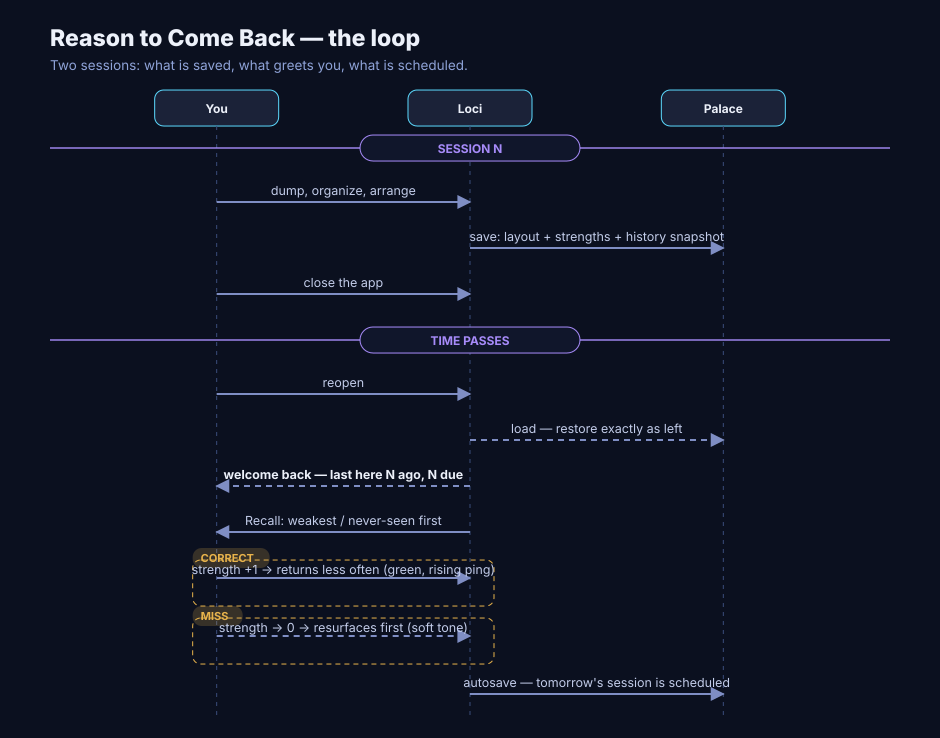
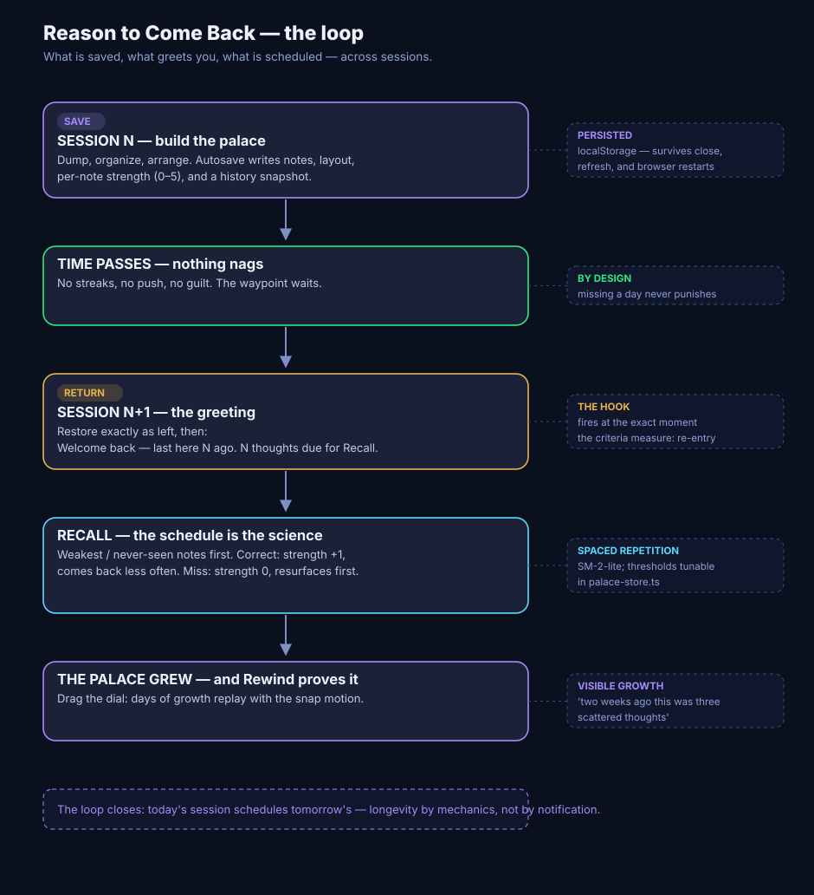

# Best Reason to Come Back — $25,000

**Judges reward:** "Thoughtful progression and reward design: something to
work toward, visible growth between sessions, and a loop that pulls the user
back tomorrow. Rewards experiences built for longevity, not a one-time demo."

## Why Loci wins it

The return loop is not a streak counter — it is **the science of memory**
plus **a place that grows**:

1. **Spaced repetition is the schedule.** Every note tracks strength 0–5 and
   times-seen (`palace-store.ts` `RecallState`). Correct recall strengthens a
   note (returns less often); a miss resets it (resurfaces first). The quiz
   picker (`recall-system.ts` `pickOrder()`) always serves the weakest first
   — tomorrow's session is scheduled by today's performance.
2. **The palace grows visibly.** Every save snapshots the layout (capped at
   30); Rewind scrubs through the growth — "two weeks ago this was three
   scattered thoughts."
3. **The return greeting makes progress land.** On re-entry the space says
   *"Welcome back — last here 3 hr ago. 4 thoughts due for Recall."*
   (`capture-system.ts` `restorePalace()`, `countDue()` in `palace-store.ts`,
   `agoLabel()` in `time.ts`) — the hook fires at exactly the moment the
   criteria measure: the decision to come back.
4. **Missing a day never punishes.** No streak shame by design — the waypoint
   just waits; the greeting says what's due, never what you failed.

## What is built (file references)

| Capability | Where |
|---|---|
| Per-note strength + seen counters (persisted) | `palace-store.ts` `RecallRecord`, `RecallState` |
| Weakest-first quiz picking | `recall-system.ts` `pickOrder()` |
| Due-count helper | `palace-store.ts` `countDue()` |
| Return greeting on restore | `capture-system.ts` `restorePalace()` |
| History snapshots (30) | `palace-store.ts` `SavedPalace.history` |
| Rewind dial (growth made visible) | `rewind-system.ts` |
| Recall grading cues (green/amber, pings) | `recall-system.ts` `answer()` |

## The flow sequence

1. **Record session A (short):** dump 5 thoughts, organize, save. Say:
   "that's today — I'll come back tomorrow." Close the app.
2. **Session B (the money shot):** reopen. The greeting: *"Welcome back —
   last here N ago. N thoughts due for Recall."* The palace is exactly as
   left — persistent, grown.
3. **Answer one recall** correctly → green glow + rising ping → say: "that
   note comes back less often now — the palace schedules my revision."
4. **Miss one** → soft neutral tone (never a failure buzz) → "and that one
   resurfaces first tomorrow."
5. **Rewind** the dial a few days → the palace plays its growth → "the
   reason to come back is watching this get bigger — and remembering more."

## Video guidance

This award is judged on the *loop*, so the video must show two sessions.
The session-break cut is the key edit: same room, greeting line, palace
intact. Keep the greeting on screen long enough to read.

## System flow — the loop across sessions (flowchart)

*Figure: two sessions with the time divide in the middle; the CORRECT and
MISS frames show how each answer reschedules tomorrow.*

*Figure: the flow view with per-section details — persistence, the
no-nag design, the greeting hook, and Rewind as visible growth.*

