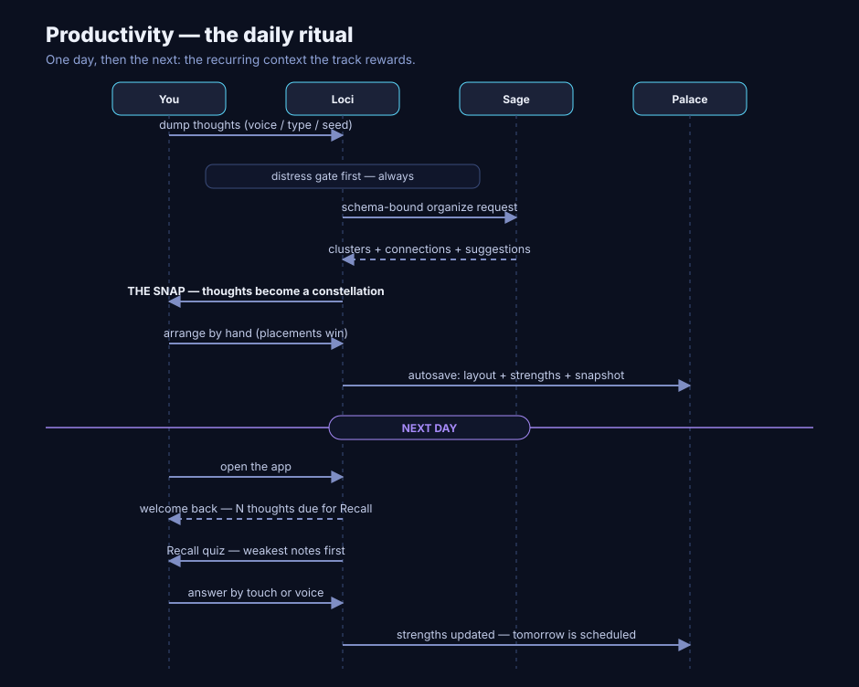

# Best New Productivity Experience — $70,000 (primary)

**Judges reward:** "Apps that make you more effective anywhere or are designed
around specific daily moments — task management, creative tools, or habits
tied to a recurring context. Hands-first implementation required." Weighted
on Innovation & Creativity, Experience Design, Technical Implementation,
Polish & Presentation (25% each). Seated, hands-first, min 60fps.

## Why Loci wins it

VR productivity is stuck on "more monitors" (Virtual Desktop, Immersed).
Loci is spatial-native and agentic: a daily two-minute thought-dump ritual
that ends with your head clear and — uniquely — a persistent palace that
makes tomorrow's visit *more* valuable than today's. Morning or wind-down,
under ten minutes, fully seated: the "airplane seat test" passes by design.

## What is built (file references)

| Capability | Where |
|---|---|
| Capture: typed, voice, spatial keyboard, seed sets | `capture-system.ts`, `capture-keyboard.ts`, `speech.ts` |
| Note birth animation: scale bloom, glow fade, shimmer tone | `ambient-system.ts` (`SpawnAnimation`), `audio.ts` (`playSpawnTone`) |
| Organize: real model (qwen3:14b) + instant local fallback | `organize-system.ts`, `model-client.ts`, `clusterer.ts` |
| The snap (the hook) | `snap-system.ts`, `audio.ts` (`playSnapChord`), particle trails |
| Arrange by hand; user placements never overwritten | `note-factory.ts` (`OneHandGrabbable`), `mouse-drag-system.ts`, `snap-system.ts` (`GrabWatchSystem`) |
| Persistence + export | `palace-store.ts` |
| Recall with spaced repetition | `recall-system.ts` |
| Rewind through history | `rewind-system.ts` |
| Desktop hand tracking (webcam) for testing without headset | `webcam-hand-system.ts` (MediaPipe HandLandmarker) |
| 72fps target + foveation | `index.ts` |

## The flow sequence (this is the daily ritual — show exactly this)

1. **Sit down, open the app** (0:00). Calm dark void. Status line in-world:
   "The space is calm. Dump a thought." — the space greets returning users
   with *"Welcome back — last here N hours ago. N thoughts due for Recall."*
2. **Dump** (0:10). Speak via the mic orb, or tap the **type** orb and use
   the spatial keyboard, or press a seed card. Each card blooms into existence — scale pop, glow surge, shimmer tone.
3. **The snap** (0:40). Touch the teal **organize** orb → "Sage is reading
   your thoughts…" → cards arc into clusters, connection lines draw in, the
   chord resolves. The orb's glow tells the truth about who did it: **gold
   = the model organized it**, gray = local fallback.
4. **Arrange** (1:00). Grab two cards, pull one out of a cluster, drop it
   where it belongs. It stays yours — Sage never moves it again.
5. **Save happens automatically** (1:20). Say it out loud: "my palace
   remembers this layout."
6. **Close.** The whole ritual: under three minutes. Tomorrow it continues
   with Recall.

## Video guidance

Lead with the snap (shot 2 on the shot list). The productivity story is the
ritual: dump → clarity → return. Close on the return greeting to prove the
recurring-context habit the criteria ask for.

## System flow — the daily ritual (sequence)

*Figure: time flows downward. The day divide marks the recurrence the
track rewards; the dashed return is the welcome-back greeting.*

